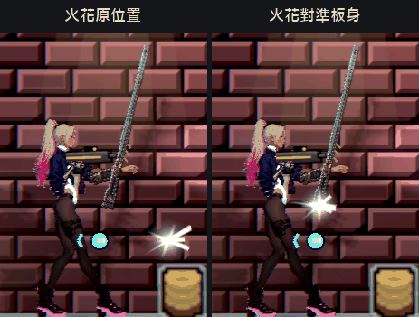

# [NE-325] 對齊偏折板的受擊火花

> 狀態：完成

## 內文

### 需求

格擋的火花、完美反彈和破防碎片隨偏折板的位置出現，讓接觸方向及硬體反應容易辨認。

### 來源

Stanley，2026-11-24，偏折板動作與特效。NE-324 實戰驗證發現普通格擋的火花仍落在板身外側。

### 驗收條件

- [x] 三種格擋配置、左右面向及斜向來襲的受擊位置皆落在板身。
- [x] 剛起手即擋住時，效果落在腕扣。普通格擋、完美反彈與破防按原條件結算。

### 測試流程

1. 在當鋪把偏折板朝左右舉起，分別觸發一般格擋、完美反彈和破防。
2. 改裝前後測試斜向子彈，確認火花出現在實體板身上的位置以及生命和防禦量變化。

---

# 跟其他票的關係

- Blocks：無
- Blocked by：無
- Related：NE-324、NE-239

---

# Commit-1

## 內文

一般格擋的火花、完美反彈和破防碎片會從腕扣或板身出現。射擊方向決定板身上的接觸位置。

### 測試結果

| 項目 | 結果 |
|---|---|
| 受影響測試 | 68 組、91,922 項檢查全過 |
| 三種配置、左右面向 | 當鋪實際子彈六次命中，板身接觸和生命值皆正確 |
| 普通格擋、完美反彈、破防 | 當鋪三種結果皆通過 |

### 截圖

