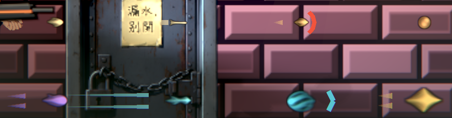

# [NE-326] 重畫飛行彈體與尾流

> 狀態：完成

## 內文

### 需求

射出的子彈從畫面看起來像方塊。依彈種重畫有方向感的彈頭與尾流，使混戰時仍能辨認來向與類型。

### 來源

Stanley，2026-11-24，武器與飛行子彈外觀。

### 驗收條件

- [x] 手槍、步槍、衝鋒槍、霰彈、電漿、磁軌、榴彈和砲彈各有可辨認的飛行輪廓。
- [x] 敵彈前緣、反彈標記與原有判定半徑維持一致。

### 測試流程

1. 在當鋪用衝鋒槍射擊並檢查飛行輪廓，再在原生場景比較八種彈體。
2. 比對命中半徑和陣營；透過偏折看回程顏色。

---

# 跟其他票的關係

- Blocks：無
- Blocked by：無
- Related：NE-269

---

# Commit-1

## 內文

飛行彈體使用帶方向和明暗的輪廓，原本方形的尾端改成淡出的短痕。不同彈種沿用既有的速度、碰撞半徑及反彈行為。

### 驗收

- RX 9070 XT Forward+ 的原生當鋪，已檢查一次實際射擊、八種彈體及反彈標記。
- 受影響套件 26 組、10,724 項，0 失敗、0 腳本錯誤。

