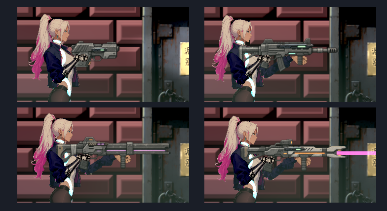

# [NE-327] 重畫高科技武器外觀

> 狀態：完成

## 內文

### 需求

將武器重畫為符合城市賽博龐克的高科技裝備。槍械輪廓在不同光線下能看出類型，角色握持與物理位置維持一致。

### 來源

Stanley，2026-11-24，武器美術與高科技風格調整。

### 驗收條件

- [x] 十種槍械、五種近戰武器及敵方兩種棍具使用一致的高科技造型。
- [x] 換槍與轉向後仍對得上握點和槍口，既有拾取及背包圖示沿用同一輪廓。
- [x] 舊槍械資料及原有擊中範圍正常。

### 測試流程

1. 在當鋪切換槍械，分別朝左右瞄準，檢查畫面中的握點、前握和槍口。
2. 比對掉落物、背包、近戰持械以及敵人的重型武器。

---

# 跟其他票的關係

- Blocks：無
- Blocked by：無
- Related：NE-260、NE-326

---

# Commit-1

## 內文

凜和敵人的武器改用冷灰合金、陶瓷與小面積診斷燈。近戰和敵方棍具更新材質輪廓。槍械採兩倍貼圖密度，使用相同的世界尺寸與三個掛點。

### 驗收

- RX 9070 XT Forward+ 當鋪檢查八種可切換槍械的兩個面向，共 16 組握點與槍口。
- 受影響回歸 74 組、96,457 項，0 失敗、0 腳本錯誤。

