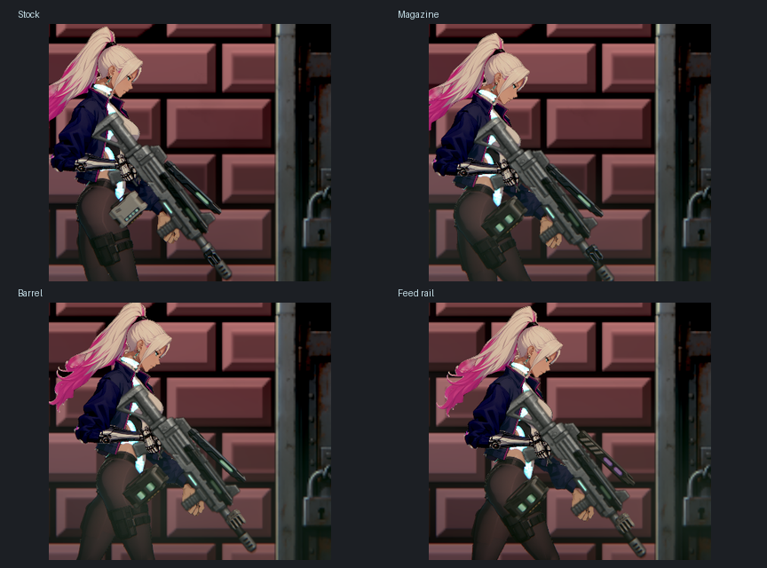

# [NE-328] 加入槍械模組與換彈變形

> 狀態：完成

## 內文

### 需求

槍械換彈期間可看到彈匣、槍管套與導軌分開動作。改裝可按部位購買，購入後在手上看到對應部位，且階級與供彈方式各有換彈動作。

### 來源

Stanley，2026-11-24，槍枝分件、換彈變形及部位升級。

### 驗收條件

- [x] 槍械依供彈方式有不同的拆裝演出，並在換彈完成後接回。
- [x] 彈匣、槍管套與導軌的外觀可各自變更，已有改裝能還原。
- [x] 原廠與一至三件改裝的換彈各有差異；切槍可正常取消換彈。

### 測試流程

1. 裝備步槍並消耗彈藥，觀察換彈時彈匣和導軌的位置。
2. 每次購買一個部位改裝，再換彈一次。確認只有購入的部位換上新樣式。
3. 等待換彈完成，接著在下一次換彈中切槍，確認彈藥和零件位置正確。

---

# 跟其他票的關係

- Blocks：無
- Blocked by：無
- Related：NE-32、NE-327

---

# Commit-1

## 內文

槍身、彈匣、槍管套與導軌分件。升級後部位換上不同輪廓與燈號，換彈時會依供彈方式、已裝部位及等級執行不同的拆裝。既有改裝、牌價、射擊和換彈完成時間仍遵守原本規則。

### 驗收

- RX 9070 XT Forward+ 實際完成四階步槍換彈，以及七種持槍的原廠換彈。涵蓋四種供彈方式，並核對三個零件的動作與彈量。
- 受影響回歸 35 組、51,949 項全過，含裝備部位、彈量與中途切槍。

