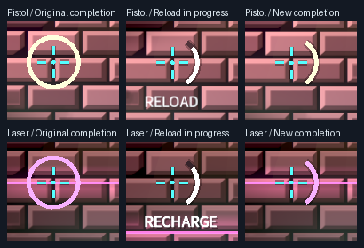

# [NE-329] 統一換彈進度與完成提示

> 狀態：完成

## 內文

### 需求

準星旁的換彈進度與完成回饋使用同一段弧。

### 來源

Stanley，2026-11-24，換彈提示的圓弧形狀不一致。

### 驗收條件

- [x] 換彈完成時以同樣半徑、位置與角度顯示填滿的短弧。
- [x] 一般換彈、能量補充及減少閃爍設定均可辨識。
- [x] 取消及重新開始換彈時保持提示與彈匣狀態一致。

### 測試流程

1. 消耗手槍一發彈藥，換彈直到提示淡出。
2. 開啟減少閃爍並用能量武器重做。
3. 換彈途中切槍，再開始換彈。

---

# 跟其他票的關係

- Blocks：無
- Blocked by：無
- Related：NE-328

---

# Commit-1

## 內文

進度與完成共用準星右側的 110 度短弧。完成時換成武器識別色後淡出。新一輪換彈和切槍會清除上一輪的完成色。

### 驗收

- RX 9070 XT Forward+ 對照手槍及雷射的換彈與補充，含減少閃爍。
- 受影響回歸 22 組、11,530 項全過。

---

# Commit-2

## 內文

換彈提示的測試會在等待影格後重新取用目前的攝影機轉換。跟拍移動時，世界提示的避讓範圍與準星旁的換彈文字使用同一個時間點的座標。

### 驗收

- 隔離的 Godot 影格測試調整攝影機後，證實舊座標會漏判，當前座標能涵蓋換彈文字。
- 受影響的戰鬥介面回歸共 237 項全過。
