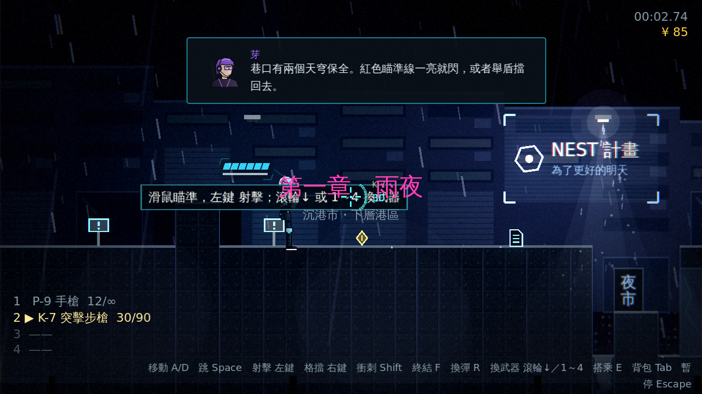
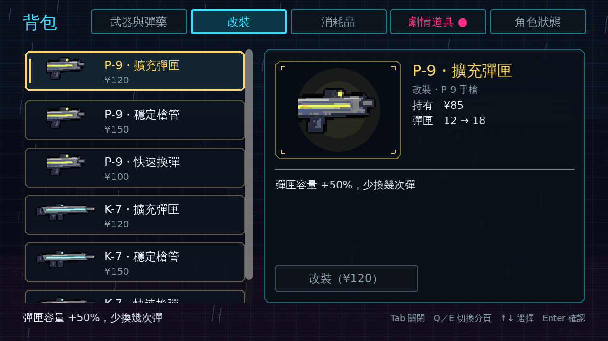
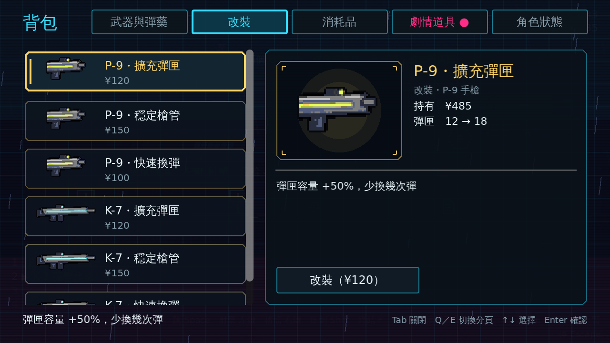
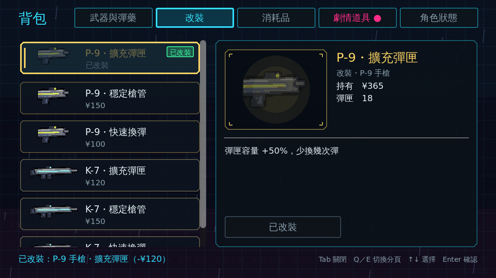

# [NE-32] 加入貨幣與武器改裝

> 狀態：完成

## 內文

### 需求
「巢蛋」存款目前只是劇情設定，沒有遊戲上的用途。加入貨幣，並讓武器可以改裝，讓玩家有累積與取捨的目標。設計見 `design/09-content/DESIGN.md` 第四節。

### 來源
2026-10-02，使用者於開發對話中提出：「讓遊戲內容更豐富」；確認四個方向都要做（第二章／新關卡、新敵人與新頭目、場景互動與探索、成長系統），順序為先光影再內容。

### 驗收條件
- [x] 關卡中可以撿到貨幣，敵人會掉落少量貨幣，畫面上顯示持有金額
- [x] 武器可改裝：擴大彈匣、減少散佈、加快換彈，改裝項目以資料定義
- [x] 改裝在背包中操作，顯示花費與改裝後的數值差異
- [x] 金額不足時無法改裝並提示
- [x] 貨幣與改裝存進檢查點，重生後還原
- [x] 三種難度下的數值平衡過：成長不會讓第一章變得毫無挑戰

### 測試流程
1. 撿取貨幣，確認金額增加
2. 在背包改裝一把武器，確認數值改變並扣款
3. 金額不足時嘗試改裝，確認被拒絕並提示
4. 通過檢查點後死亡，確認貨幣與改裝還原
5. 執行完整測試套件，全部通過

---

# 跟其他票的關係

- Blocks：NE-33
- Blocked by：NE-25
- Related：NE-16、NE-33

---

---

# Commit-1

## 內文

「巢蛋」有了遊戲上的用途。新增貨幣「信用點」：關卡中撿得到（小堆 10、隱藏房間的大堆 40）、敵人被擊敗會掉少量（5～25，頭目 100）、貨箱破壞掉 15，右上角 HUD 顯示持有金額（增加與花費時閃色）。武器可改裝：擴充彈匣 +50%、穩定槍管散佈 -30%、快速換彈 -25%，改裝項目是資料（`data/upgrades/`），價格 100～150、每把武器每項只能買一次，只改手感不改傷害與射速。背包新增「改裝」分頁（分頁標籤寬度改為依數量自動縮放）：列出攜帶武器可買的項目，顯示花費與改裝前後的數值對照，金額不足時按鈕停用並提示還差多少，買了立刻生效（彈匣變大時多出的子彈直接補進彈匣）。
成長進度（信用點、改裝）存進檢查點：從檢查點重生還原成檢查點當下，沒有檢查點（殘機用盡）還原成進入關卡時，新一輪歸零；地圖上撿過的信用點堆也存進檢查點，所以不能靠死亡重撿刷錢。武器欄現在同時保存原始資料與改裝後的副本，存檔只存原始資料路徑，沒有改裝時行為與原本完全相同。壞掉的存檔快照不會讓遊戲崩潰。第一章放了 11 堆小堆與隱藏房間的 1 大堆。
平衡：三種難度共用同一套價格與數值，改裝不影響傷害與射速，幅度與價格有測試鎖定（幅度 ≤ 60%、價格 ≥ 50）。
驗收方式：測試驗證改裝資料與驗證、信用點增減與上限、改裝的購買／重複／不適用／不足、改裝後數值與原資料不被修改、武器欄套用與存檔還原、快照損毀容錯、撿取與 HUD、檢查點還原與不能重撿、敵人與箱子掉落、改裝頁的列表／預覽／拒絕／購買；截圖如下。

### 測試結果

| 項目 | 結果 |
|---|---|
| 完整測試套件 | 通過 1341 / 1341 |
| 資料驗證 | 0 錯誤 |
| 執行 log | 無非預期 ERROR |

### 截圖

