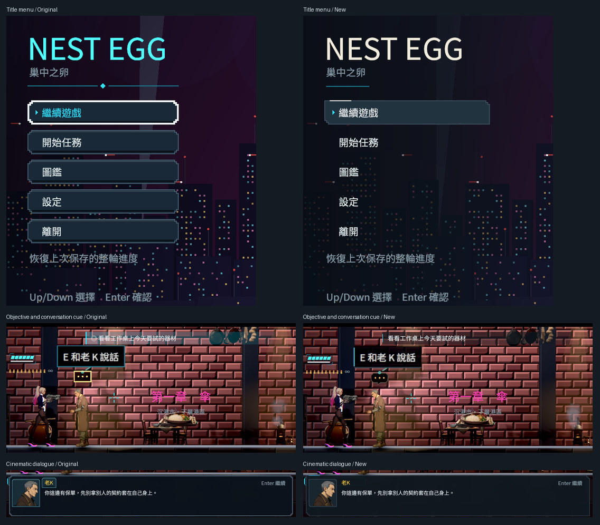

# [NE-330] 重整主選單與共用介面材質

> 狀態：完成

## 內文

### 需求

主選單、任務橫幅、互動提示與對話框使用一致的介面材質。利用字級、留白與焦點分出資訊層級，讓場景保持可讀。

### 來源

Stanley，2026-11-24，任務橫幅、頭頂對話提示、劇情對話框及初始選單的美術。

### 驗收條件

- [x] 主選單保留城市背景，未選項、Hover 與鍵盤焦點可辨。
- [x] 任務、互動與對話各有辨識度，適用於世界內與共用介面。
- [x] 既有對話、通訊、任務語言、文字縮放及選單操作的受影響測試通過。

### 測試流程

1. 開啟主畫面，使用方向鍵移動並觀察操作提示。
2. 進入第一章當鋪，查看任務指引、老 K 的交談提示與對話。
3. 切換語言、調整文字大小並開啟通訊及設定，核對閱讀與焦點。

---

# 跟其他票的關係

- Blocks：無
- Blocked by：無
- Related：NE-227、NE-228、NE-274

---

# Commit-1

## 內文

共用面板與提示採石墨底、細鋼色沿與短色線。主選單使用暖白標題與低干擾動作列。對話移除重複的姓名框，通訊保留講者色條與訊號。世界提示依用途使用薄底或對話形狀。

### 驗收

- RX 9070 XT Forward+ 擷取主選單、第一章當鋪任務／互動及老 K 對話，同條件對照。
- 受影響回歸 66 組、66,176 項全過。

