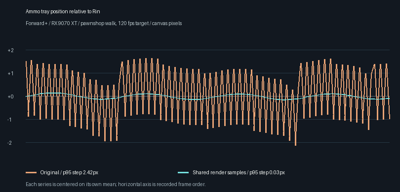

# [NE-331] 穩定移動彈帶與預載影格

> 狀態：完成

## 內文

### 需求

移動時彈帶清楚可讀。切換區域或預載資源時，重複的貼圖載入給遊戲保留可用影格。區域建置和可操作後的耗時分別可量測。

### 來源

Stanley，2026-11-24，移動時彈帶模糊、到新地方時有卡頓。

### 驗收條件

- [x] 用實際移動的連續影格驗證彈帶與凜的位置同步。
- [x] 瞬移更新位置並防止拖影，生命提示與彈帶維持同一套避讓位置。
- [x] 原生貼圖預載超出預算後留下一個影格給遊戲，後續繼續處理。
- [x] 受影響回歸全過並留下建置與操作影格量測。

### 測試流程

1. 持槍在第一章當鋪往前走，逐格量彈帶相對角色的位置。
2. 在關卡入口切換區域，觀察建置與建置後的獨立耗時。
3. 預載排滿時核對恢復影格與佇列是否排空。

---

# 跟其他票的關係

- Blocks：無
- Blocked by：無
- Related：NE-212、NE-264、NE-329

---

# Commit-1

## 內文

畫面的彈帶、生命提示與角色使用一致的物理插值。預載單次解碼或上傳超過主執行緒的軟預算時，保留下一個畫面給遊戲後自動續跑，沿用既有上限。

### 驗收

- Forward+ 在相同當鋪步行路線擷取 125／124 影格，彈帶相對角色的逐幀位移第 95 百分位由 2.42 降至 0.03 畫布像素。
- 當鋪、街道和市集操作取樣中均無超過 33.3 ms 的影格，三區的預載佇列均排空。冷建置仍有較長影格，建置耗時另由工具的 `--entry` 記錄，正式換區後的長影格另行調查。
- 受影響回歸 68 組、91,993 項全過。

