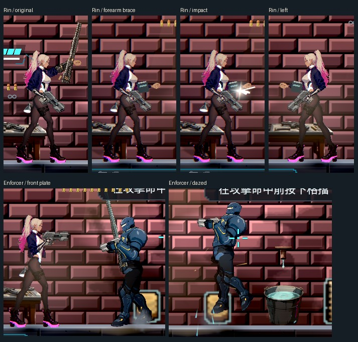

# [NE-332] 凜改用前臂格擋並移交伸縮板

> 狀態：完成

## 內文

### 需求

凜使用容易辨識、合理受力的格擋姿勢。伸縮式金屬偏折板用於具有正面防禦與破綻的敵人。

### 來源

Stanley，2026-11-24，格擋是常見動作，請重做手的位置及防護方式，把原金屬偏折板交給合適的敵人。

### 驗收條件

- [x] 左右格擋均收肘，以前臂接力，實彈命中的短脈衝落在受力位置。
- [x] 原伸縮板由鎮暴員部署，正面能格擋，暈眩會收板。
- [x] 不同武器、空手、反彈、破防、部位升級、存檔與舉擋移動的受影響回歸通過。

### 測試流程

1. 持槍與空手朝左右格擋，觀察腳底、手腕、抬臂與收手。
2. 用敵方射擊驗證一般格擋、完美反彈和破防。
3. 正面射擊鎮暴員，誘導衝撞後從可攻擊方向輸出。

---

# 跟其他票的關係

- Blocks：無
- Blocked by：無
- Related：NE-239、NE-269、NE-324、NE-325

---

# Commit-1

## 內文

凜改用收肘的前臂防護，命中時在外殼旁出現短脈衝。槍收在腰側，長柄近戰與前臂維持間距。方向判定、窗口、消耗和升級沿用原規則。伸縮偏折板轉由鎮暴員部署，暈眩時收起。

### 驗收

- RX 9070 XT Forward+ 擷取凜的左右格擋、實彈碰撞與鎮暴員展開／暈眩。依角色所在位置裁切原生畫面。
- 受影響回歸 77 組、101,274 項全過，含掉幀時格擋、長柄近戰、零件升級與存檔。

