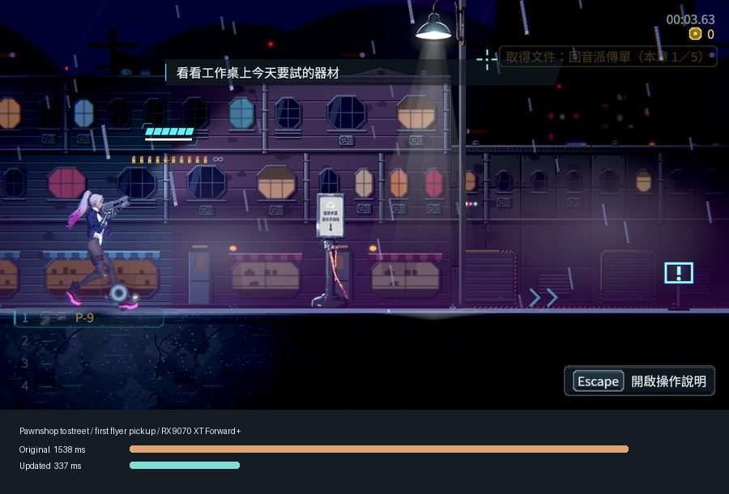

# [NE-333] 減少拾取與劇情存檔的重複驗證

> 狀態：完成

## 內文

### 需求

拾取文件和結算劇情時，避免存檔在同一影格反覆掃描武器、交易和地圖。保留存檔與當前世界狀態的一致性，量測正式遊戲路線。

### 來源

Stanley，2026-11-24，走進新區域或靠近互動物時明顯卡頓。

### 驗收條件

- [x] 由正式路線進入第一章街道時，定位首次拾取傳單的長影格。
- [x] 同一交易可重用正確的資料目錄及所在區域的地圖。使用現有地圖的驗證結果與重新讀取一致。
- [x] 遊戲內只取得一次文件，重新從存檔讀取時可查到。
- [x] 受影響回歸通過，保留驗證失敗與回復流程。

### 測試流程

1. 使用新進度，經正式換區流程由當鋪進入街道。
2. 正常往前走到第一次拾取回音派傳單，記錄拾取前後的影格。
3. 用同一存檔讀取流程核對物品狀態。檢查原有中止和無效存檔測試。

---

# 跟其他票的關係

- Blocks：無
- Blocked by：無
- Related：NE-331

---

# Commit-1

## 內文

同一筆耐久寫入共用已驗證的武器與交易資料。在地圖身分相同時，沿用當前區域已解析的配置，其他區域正常讀取。存檔樹走訪重用短路徑，遇到錯誤才組裝診斷。候選資料和實際磁碟內容仍做完整驗證。

### 驗收

- RX 9070 XT Forward+ 正式當鋪轉街道路線重現 1,538 ms 的拾取影格，修改後重測約 337 至 384 ms。正常拾取只發一次，從存檔也能讀到物品。
- 受影響回歸共 50 組、57,654 項檢查，零失敗。
- 本次縮短自動拾取的尖峰；同一路線仍有約三分之一秒的拾取影格，和約 159 至 220 ms 的進區建置尖峰。

