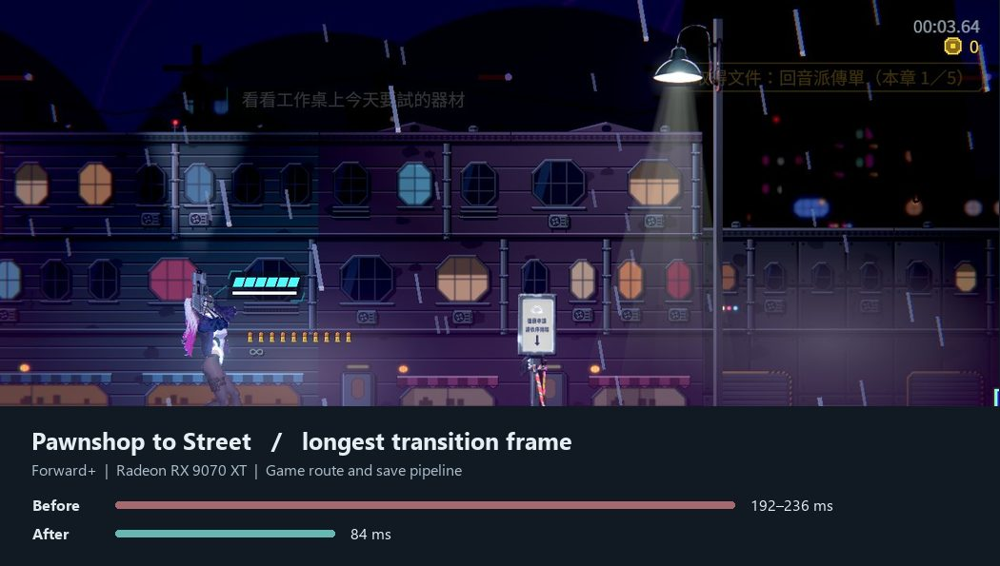

# [NE-334] 將鄰區貼圖探索分散到多影格

> 狀態：完成

## 內文

### 需求

在區域進場時分批探索鄰居要使用的貼圖。保留原有先載哪些貼圖、快取預算及離開區域時的清理。

### 來源

Stanley，2026-11-24，走進新區域時有明顯停頓。正式當鋪轉街道路線上，鄰居貼圖探索單次佔用約 123 至 166 ms。

### 驗收條件

- [x] 同一個關卡由分批探索及診斷工具取得一致的貼圖清單。
- [x] 快速改區或清除時不會留下前一區的探索。正常預載可排空。
- [x] 在正式換區及受影響測試驗證。

---

# 跟其他票的關係

- Blocks：無
- Blocked by：無
- Related：NE-331、NE-333

---

# Commit-1

## 內文

保留每個區域的原有預載範圍，依區域和影格分段檢查候選貼圖，同一個路徑只檢查一次。換區會撤銷尚未完成的探索並保留原有佇列與快取預算。格擋受力姿勢跟著骨架推進，避免在較慢的畫面更新後漏掉動作。

### 驗收

- RX 9070 XT、Forward+ 正式當鋪轉街道路線，最長換區影格由約 192 至 236 ms 降至約 84 ms。
- 釋放及替換探索範圍後，預載佇列排空。格擋回歸刻意先讓畫面特效結束，再檢查前臂仍有受力姿勢。

- 受影響回歸共 67 組、90,992 項檢查，零失敗。

