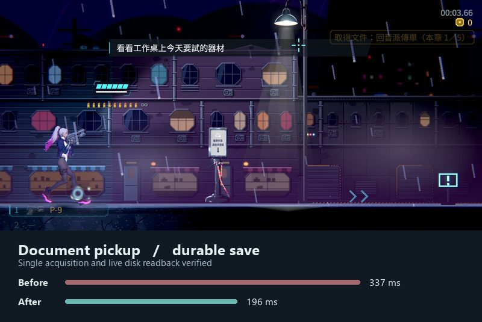

# [NE-335] 縮短拾取及劇情存檔的狀態重查

> 狀態：完成

## 內文

### 需求

再降低自動拾取及劇情存檔造成的長影格。保留存檔和目前世界的一致性，拒絕過期或損毀的存檔候選。

### 來源

Stanley，2026-11-24，走入互動物範圍時有頓挫。NE-333 修改後仍可在首次拾取傳單重現約 337 至 384 ms 的影格。

### 驗收條件

- [x] 正式換區後正常拾取回音派傳單，縮短該影格並確認只取得一次。
- [x] 存檔能讀回取得的文件，狀態型別變更、欄位重排及錯誤資料會擋下重查。
- [x] 受影響測試通過，改裝、劇情及存檔回復正常。

---

# 跟其他票的關係

- Blocks：無
- Blocked by：無
- Related：NE-333、NE-334

---

# Commit-1

## 內文

用已驗證且分離的狀態重查進度前後的變化。比較順序與欄位型別，遇到無效資料才補上錯誤路徑。空白的改裝記錄直接通過，實際改裝從同一份武器目錄核對。

### 驗收

- RX 9070 XT Forward+ 正式當鋪轉街道路線，首份傳單從 NE-333 實測 337 ms 再降至 179 至 196 ms，存檔讀取確認物品存在。
- 受影響回歸 50 組、57,665 項檢查，零失敗。實際工作目錄另重跑存檔套件 1,033 項，零失敗。
- 拾取仍有可感受到的停頓。本票保留原本的原子寫入及失敗回復流程。

