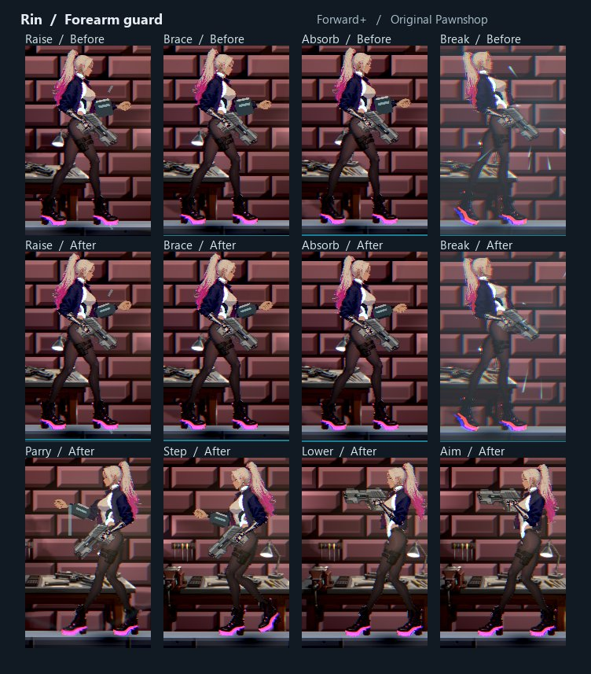

# [NE-337] 改善前臂格擋的動作銜接

> 狀態：完成

## 內文

### 需求

讓凜的前臂格擋有合理的重心與受力。抬臂、持槍手收低、受擊和收回要連續，能看出一般格擋、完美偏轉與破防的區別。

### 來源

Stanley，2026-11-24，要求優化整體格擋動畫與動作。

### 驗收條件

- [x] 起手與收手時，手和武器連續移動，兩側腳步與地面位置合理。
- [x] 碰撞驗證一般格擋屈肘、完美格擋偏轉與破防收回。持槍、近戰和空手保持可操作。
- [x] Forward+ 實機核對動作與外觀，受影響回歸通過。

### 測試流程

1. 左右兩側各按住、放開格擋，觀察站姿與移動。
2. 讓子彈在不同時機命中，觀察受力與恢復。
3. 持槍、近戰及空手各測，放開格擋立即射擊。

---

# 跟其他票的關係

- Blocks：無
- Blocked by：無
- Related：NE-239、NE-332

---

# Commit-1

## 內文

收槍和舉臂沿手的握點連續過渡。一般格擋由前臂與上身卸力，完美格擋向前偏轉，破防逐步降下架勢。護具使用較薄的倒角外殼與凹入的發光條，手腕動作更清楚。

### 驗收

- RX 9070 XT Forward+，原當鋪真實控制與來襲子彈。第一格槍相對骨盆的水平移動從 2.87 降到 0.53 個世界像素，支撐肘相對肩膀的移動從 3.71 降到 1.10。一般格擋的手腕有 2.88 個世界像素卸力幅度，完美反彈、破防及行進皆另外取樣。

- 以 3.4 倍檢查兩面向與減少閃光玩法。站姿與命中代表格的腳底誤差不超過 0.15 個骨架像素，行進樣本支撐腳誤差 0.09，另一腳正常邁步。

- 受影響回歸 66 組、94,738 項，零失敗。包含左右面向、持槍、近戰及空手、格擋步態、放開格擋首發與三種命中結果。

