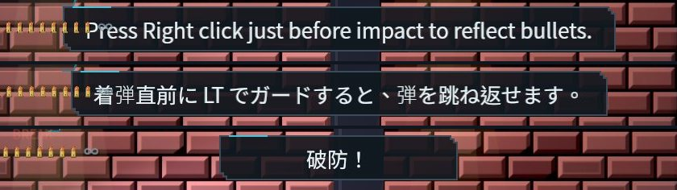

# [NE-338] 統一格擋與頭目戰提示

> 狀態：完成

## 內文

### 需求

一般格擋、破防和頭目弱點的提示用目前語言。提示要對應前臂格擋、真實按鍵和血條上的頭目名稱。

### 來源

2026-11-25 接續 NE-228 與 NE-337。首次格擋和破防固定顯示中文，完整操作頁仍以舉盾描述前臂格擋。

### 驗收條件

- [x] 在三語戰鬥中看到正確的格擋提示。手把與鍵鼠切換後，顯示中的按鍵也切換。
- [x] 普通格擋、破防、頭目裝甲和弱點提示仍在原事件顯示。頭目名稱跟著當前語言。
- [x] Forward+、放大文字下看過實際命中提示，受影響測試通過。

### 測試流程

1. 在原關卡擋下一發子彈，保持提示開啟時切換鍵鼠與手把。
2. 另一發耗盡格擋值，確認破防提示。觸發頭目露出弱點及加強階段。
3. 分別用繁中、日文和英語檢查。

---

# 跟其他票的關係

- Blocks：無
- Blocked by：無
- Related：NE-228、NE-239、NE-337

---

# Commit-1

## 內文

首次擋下實際子彈及格擋值耗盡時，遊戲顯示目前語言。更換裝置時，顯示中的提示會換成目前格擋鍵。完整操作說明與格擋值的提示改用現有的前臂格擋用語。頭目的裝甲、破綻和強化提示沿用血條名稱及現有觸發時機。

### 測試結果

| 項目 | 結果 |
|---|---|
| 受影響的遊戲測試 | 68 組，92,029 項，全過 |
| RX 9070 XT Forward+，120% 文字 | 原關卡用實際子彈測三語、鍵鼠／合成手把切換及破防 |

### 截圖

