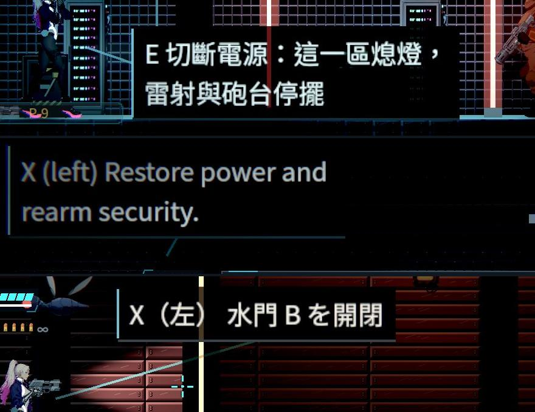

# [NE-339] 讓機關提示對應語言與現況

> 狀態：完成

## 內文

### 需求

在繁中、英語及日文能看懂閘門、開關、升降梯、水坑與遭遇的提示。電力開關根據目前狀態說明下一個動作。

### 來源

2026-11-25 接續 NE-228 的介面整理與 NE-240 的探索提示。切換劇本語言後，部分場景提示仍顯示繁中，停電後也依然提示切斷電源。

### 驗收條件

- [x] 三語的關卡機關及遭遇提示完整，未翻譯的舊資料沿用原文或英文。
- [x] 改綁設定和切換輸入裝置時，互動提示顯示目前按鍵。
- [x] 通電、停電及讀取檢查點後都顯示正確的下一步；載入時不重播電力通知。
- [x] 在實際關卡以 Forward+ 驗證，受影響測試通過。

### 測試流程

1. 以三種語言進入關卡，靠近閘門、開關及升降梯並檢查可用操作。
2. 切換電力並還原檢查點，檢查停電前後的提示和通知。
3. 啟動踏板與遭遇，確認原有機關、通道和敵人流程。

---

# 跟其他票的關係

- Blocks：無
- Blocked by：無
- Related：NE-228、NE-240

---

# Commit-1

## 內文

閘門、升降梯、開關、淹水和遭遇以目前語言顯示提示。供電時的電力開關說明斷電效果，停電時說明恢復供電會重新啟動保全。檢查點還原會切換提示，但不再播放通知。

### 測試結果

| 項目 | 結果 |
|---|---|
| 受影響的遊戲測試 | 45 組，26,837 項，全過。一個平行引擎程序中止，該程序六組另重跑全過 |
| RX 9070 XT Forward+，120% 文字 | 三語的實際機關、鍵鼠與合成手把切換、斷電與恢復、還原時的下一步 |

### 截圖

