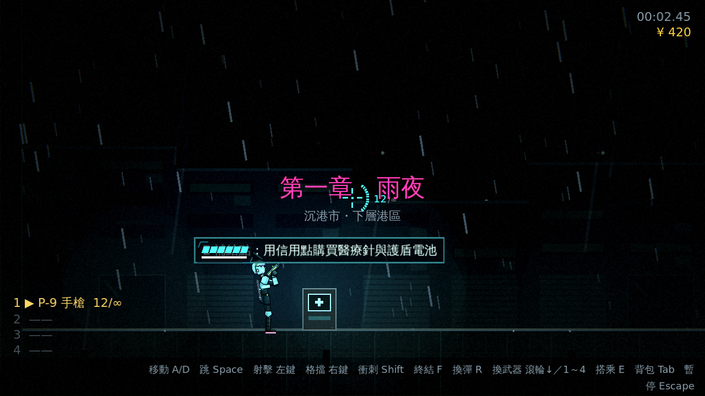
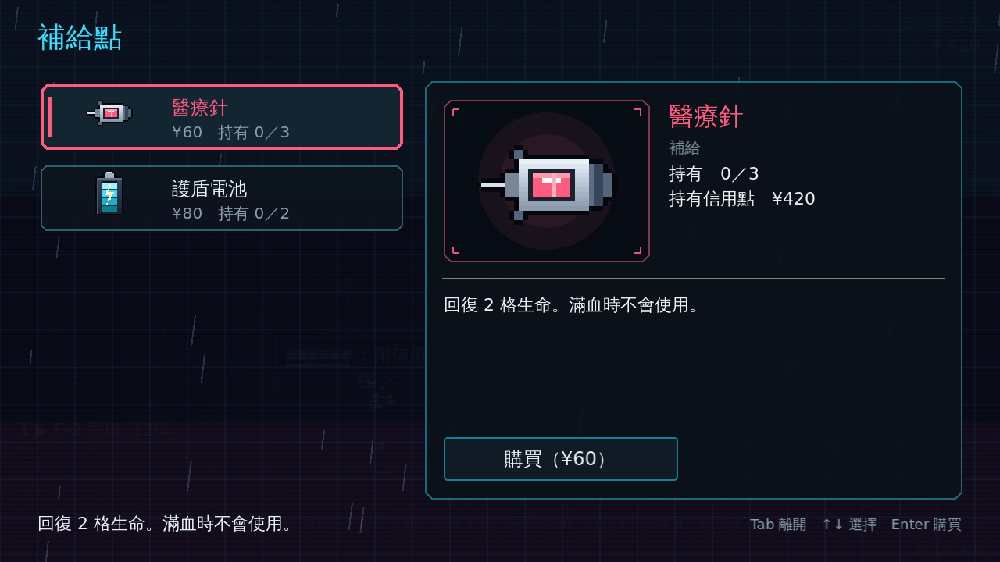
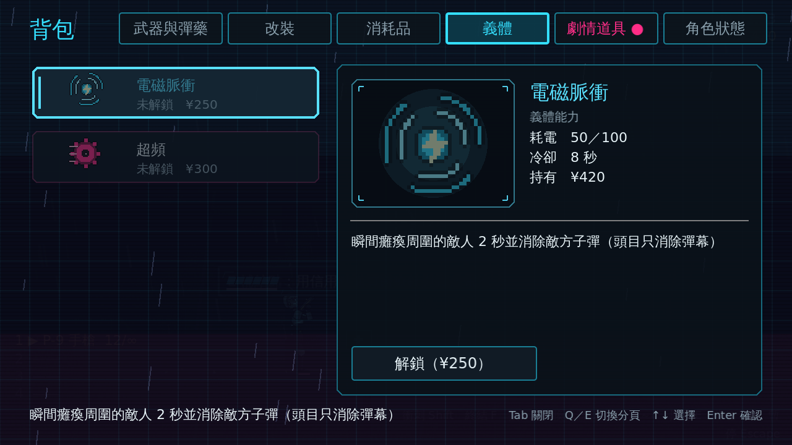
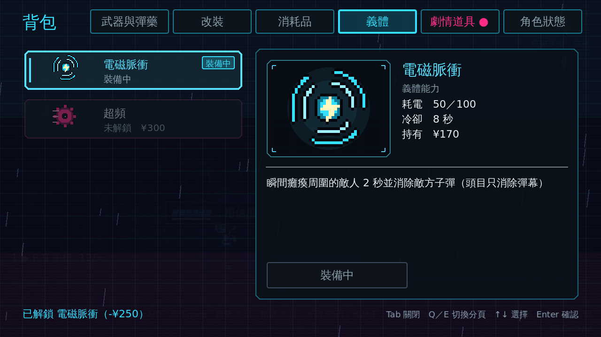
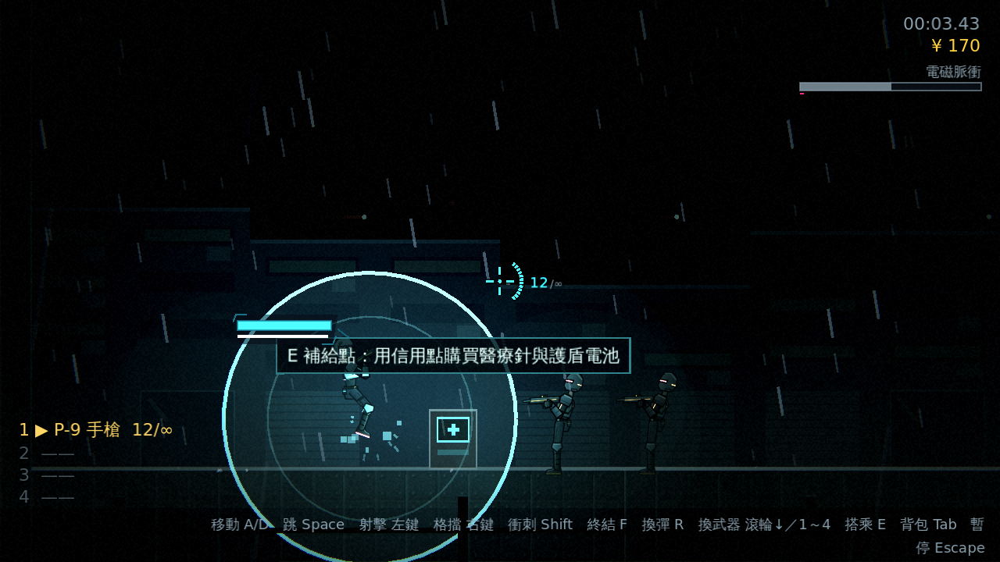
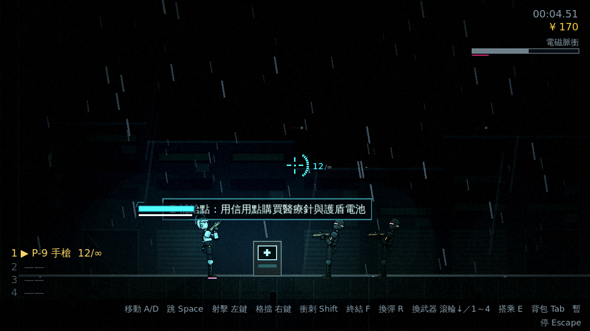

# [NE-33] 加入義體能力與補給商店

> 狀態：完成

## 內文

### 需求
有了貨幣之後需要花費的地方。加入關卡中的補給商店，以及可解鎖的義體能力，讓成長有更多方向。設計見 `design/09-content/DESIGN.md` 第四節與 `design/06-roadmap/open-questions.md`。

### 來源
2026-10-02，使用者於開發對話中提出：「讓遊戲內容更豐富」；確認四個方向都要做（第二章／新關卡、新敵人與新頭目、場景互動與探索、成長系統），順序為先光影再內容。

### 驗收條件
- [x] 關卡中有補給點，可用貨幣購買醫療針與護盾電池，受攜帶上限限制
- [x] 可解鎖義體能力，能力的種類、消耗與冷卻依設計定案的清單，並以資料定義
- [x] 能力在背包中查看與裝備，使用時有明確的畫面與聲音回饋
- [x] 每個商店與能力項目都有一句 tooltip 說明
- [x] 購買與解鎖的結果存進檢查點，重生後還原

### 測試流程
1. 在補給點購買消耗品，確認扣款與攜帶上限
2. 解鎖並使用一項義體能力，確認消耗、冷卻與回饋
3. 通過檢查點後死亡，確認購買與解鎖還原
4. 執行完整測試套件，全部通過

---

# 跟其他票的關係

- Blocks：無
- Blocked by：NE-32
- Related：NE-32

---

---

# Commit-1

## 內文

信用點有了第二個去處。關卡裡有補給點（第一章兩個，各在檢查點旁）：站在旁邊按互動鍵開啟貨架，可用信用點買醫療針（¥60）與護盾電池（¥80），受攜帶上限限制，放不進背包就不扣款；貨架沿用背包的版面與操作（只有一頁，按背包鍵離開），商品是資料（`data/shops/*.tres`），價格取自消耗品資料。
新增義體能力（決定做：電磁脈衝與超頻，不做子彈時間）：電磁脈衝瞬間癱瘓周圍敵人 2 秒並消除敵方子彈（頭目只消除彈幕）；超頻 4 秒內射速與換彈快 40%、移動快 15%。有義體電量（0～100，隨時間與擊敗敵人回復）與冷卻，使用鍵預設 C，HUD 右上角顯示電量條與冷卻進度；能力在背包新增的「義體」分頁查看、用信用點解鎖（第一個自動裝備）與切換裝備，使用時有畫面（擴散的脈衝環／旋轉的光弧）與聲音回饋。能力是資料（`data/abilities/*.tres`）。
購買的結果存進檢查點：解鎖與裝備跟著成長進度還原。每個商店與能力項目都有一句 tooltip／說明。順帶：背包畫面改成可由子類別提供標題與分頁（補給點就是它的子類別），測試固定的分頁位置改成依分頁類型查找；修正一個依幀率而偶發失敗的光影測試（改為等到過渡完成，最多 2 秒）。
驗收方式：測試驗證能力與商店資料（含冷卻大於持續時間）、解鎖／裝備規則與快照容錯、電量回復與擊敗回充、冷卻與電量不足與倒下時的拒絕、電磁脈衝範圍與只清敵方子彈與頭目不受暈眩、超頻倍率與實際射擊間隔與結束恢復、補給點開啟與暫停、購買與不足與上限、關閉與過關時自動關閉、義體頁解鎖／裝備／拒絕、檢查點還原；截圖如下。

### 測試結果

| 項目 | 結果 |
|---|---|
| 完整測試套件 | 通過 1419 / 1419 |
| 資料驗證 | 0 錯誤 |
| 執行 log | 無非預期 ERROR |

### 截圖

