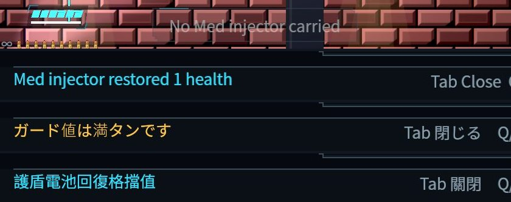

# [NE-340] 讓消耗品提示反映實際回復

> 狀態：完成

## 內文

### 需求

快速鍵與背包顯示一致的失敗原因，配合目前遊戲語言。背包顯示實際回復量和格擋狀態。

### 來源

2026-11-25 接續 NE-228 與 NE-244。戰鬥中用快速鍵失敗只顯示中文，背包也會在只補一格血時顯示補了兩格。

### 驗收條件

- [x] 快速鍵和背包在三語下都能說清楚缺貨、滿血或格擋已滿。
- [x] 背包只回報實際補回的血量與格擋效果；用不上時不消耗物品。
- [x] 在實際關卡驗證快速鍵及背包，受影響測試通過。

### 測試流程

1. 空身與滿血時各按一次快速鍵，確認提示和存貨。
2. 受傷一格後從背包用醫療針，確認訊息顯示回復一格。
3. 分別在滿格擋、耗損及破防時使用電池。

---

# 跟其他票的關係

- Blocks：無
- Blocked by：無
- Related：NE-228、NE-244

---

# Commit-1

## 內文

空身、滿血或格擋值已滿時，遊戲用目前語言說明用不了的原因。從背包使用只補一格血的醫療針時，狀態列顯示回復一格。破防時仍可用電池解除，滿血或滿格擋而用不上時，庫存維持原數量。

### 測試結果

| 項目 | 結果 |
|---|---|
| 受影響的遊戲測試 | 68 組，92,053 項，全過 |
| RX 9070 XT Forward+，120% 文字 | 第一章當鋪用快速鍵與背包核對三語、實際血量、庫存和解除破防 |

### 截圖

