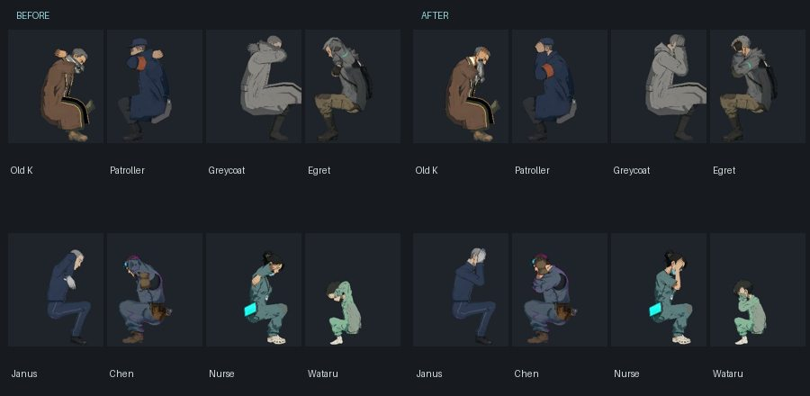

# [NE-342] 修正 NPC 蹲身護頭的關節

> 狀態：完成

## 內文

### 需求

附近出現連續聲響時，NPC 抬起手保護頭部。手肘能自然彎曲，手位於頭部兩側，蹲下和起身時腳掌著地。

### 來源

2026-11-25 玩家回報 NPC 縮身時的肢體位置不自然。

### 驗收條件

- [x] 實際 NPC 蹲下護頭時，左右朝向的手腕均能靠近頭部，肘部不反折。
- [x] 站、蹲、護頭及起身的接地、一般工作與交談行為通過原有檢查。
- [x] 實機觀察與受影響測試通過。

### 測試流程

1. 用角色資料重播察覺聲響、下蹲、護頭和恢復。
2. 檢查不同身高、臂長的 NPC 在兩種面向的近拍和關節。
3. 在正式場景檢查原本的對話和工作循環。

---

# 跟其他票的關係

- Blocks：無
- Blocked by：無
- Related：NE-240、NE-250

# Commit-1

共用護頭動作依角色的肩、頭部與臂長解算，限制肘部和手腕角度，解除後回到原姿勢。

- Forward+：八種外觀在同一鏡位下的前後對照。
- 受影響測試：其餘分片通過，更新動畫資料斷言後重跑 NPC 行為與骨架套件，2,310 項檢查通過。

