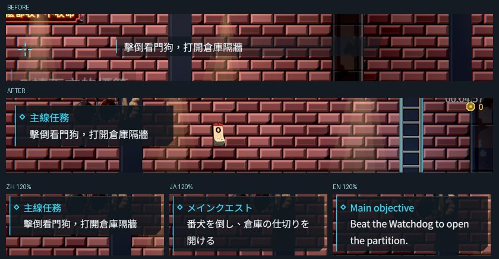

# [NE-343] 重做遊玩中的任務欄

> 狀態：完成

## 內文

### 需求

遊玩時看得出目前追蹤的是任務，字卡只占需要的空間。任務更新有短暫的動態，世界指引和通知各自容易辨認。

### 來源

2026-11-25 玩家提供「擊倒看門狗，打開倉庫隔牆」截圖，表示任務與一般提示難以分辨，並請參考有動畫的遊戲 UI。

### 驗收條件

- [x] 第一章看門狗任務出現在左上任務欄，有來源與完整步驟；出現可達的跨區導引時仍顯示原有目的地。
- [x] 目標切換只更新一次；減少動態時直接換字。通訊、閱讀及暫停時保留原有遮擋與操作。
- [x] 以 Forward+ 驗證三語與 120% 文字，通過受影響測試。

### 測試流程

1. 進入正式當舖並定位看門狗任務，核對任務字卡與前往倉庫的路標。
2. 切換釘選、任務步驟與減少動態，核對更新次數和版面。
3. 調整語言及文字大小後打開閱讀、通訊及任務目錄。

---

# 跟其他票的關係

- Blocks：無
- Blocked by：無
- Related：NE-223、NE-228

# Commit-1

以穩定的左上任務欄顯示主線、支線或釘選，目的地改用獨立的低亮度指引。目標改變時短暫點亮字卡；閱讀或生命、彈藥資訊壓住這個位置時，先保留該資訊。

- 原生 Forward+ 當舖場景：繁中、日文及英文 120% 的看門狗目標、步驟更新與減少動態。
- 受影響測試：11,575 項通過，涵蓋跨區指引、提示避讓、通訊與暫停。

