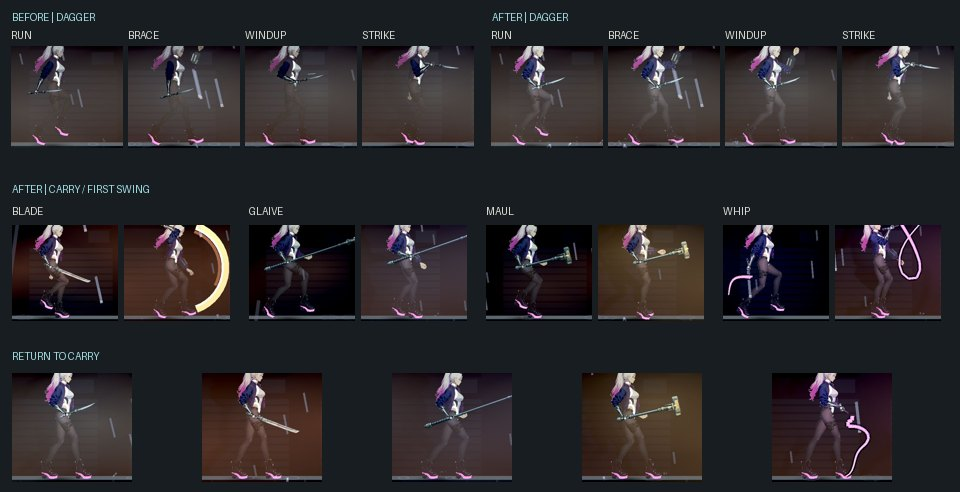

# [NE-344] 讓近戰持武、格擋與收招連貫

> 狀態：完成

## 內文

### 需求

凜持近戰武器移動的手位與武器朝向自然，能順暢接前搖、出招和收招。格擋前臂能支撐攻擊並讓手肘低於手部，收肘後接回武器動作。

### 來源

2026-11-25 玩家回報持匕首移動、攻擊及格擋姿勢不連貫，要求以合理姿勢為基礎重整近戰骨架呈現。

### 驗收條件

- [x] 固定朝向的四把剛性武器具個別持握姿勢，移動、格擋、前搖與收招可相接。
- [x] 五把武器均可在兩個朝向從移動接格擋與攻擊。雙手接觸、既有打擊時機和軟鞭傳波通過回歸。
- [x] 實機連續取樣與受影響範圍測試通過。

### 測試流程

1. 在相同鏡位以兩個朝向移動、格擋、進攻，逐格核對站姿及握點。
2. 順序檢查兩種方向的打擊關節、實際傷害及柔性鞭身形態。

---

# 跟其他票的關係

- Blocks：無
- Blocked by：無
- Related：NE-237、NE-239、NE-275、NE-277

# Commit-1

四把剛性武器新增以肩、掌心為基準的持握資料；前搖與收招共用持握權重。格擋調整前臂與手腕的支撐位置；柔性武器保留逐節傳波。

- 原生 Forward+：五把武器、兩個朝向，從移動到格擋、第一段攻擊、收回。
- 受影響測試：66 組、94,976 項通過。保留軟鞭傳波後另重跑場景、骨架與武器測試，8,768 項通過。

