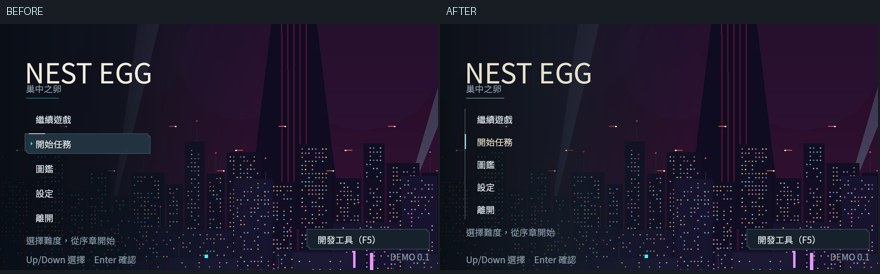

# [NE-345] 重整主選單導覽與焦點

> 狀態：完成

## 內文

### 需求

重新安排主選單的標題、導覽和提示，讓城市背景留有空間。焦點需要一眼可見，游標、鍵盤與手把進行切換時不影響按鍵反應。

### 來源

2026-11-25 玩家回報整體介面缺乏美術一致性，先改遊玩任務欄，接著延伸到先前點名的初始選單。

### 驗收條件

- [x] 主選單保留繼續、新遊戲、圖鑑、設定與離開，操作提示與所在列相符。
- [x] 焦點與游標使用共用側線指示，開啟減少動態直接到位。
- [x] 繁中、日文、英文 120% 文字下，操作提示與頁腳保有各自空間；進入難度頁與返回焦點運作正常。

### 測試流程

1. 啟動正式選單並透過鍵盤選擇新遊戲，確認說明和標記更新。
2. 開啟難度頁後返回，確認焦點回到新遊戲。
3. 在三種語言開啟文字放大和減少動態，對照畫面與共用介面測試。

---

# 跟其他票的關係

- Blocks：無
- Blocked by：無
- Related：NE-228、NE-343

# Commit-1

主選單改用固定清單與側邊焦點線，游標和焦點移動時保持列的位置。提示保留在清單下方，有減少動態時焦點線直接到位。

- 原生 Forward+：繁中、日文、英文以 120% 文字從繼續切換到新遊戲，進難度頁後返回。
- 受影響測試：8,429 項檢查。高併發時通訊淡出 fixture 超時，獨立重跑 UiScreensSuite 813 項全部通過；其他分片皆通過。

