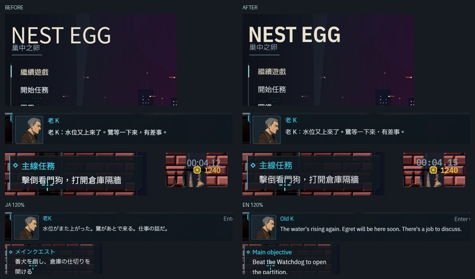

# [NE-347] 更換遊戲字型與特殊讀數

> 狀態：完成

## 內文

### 需求

讓遊戲的選單、對話、任務及一般提示採用好讀且一致的字。標題與系統數字有各自的視覺個性。

### 來源

2026-11-25 玩家要求挑選並替換遊戲字型，允許特殊用途使用更有特色的字。

### 驗收條件

- [x] 常用介面文字以新字型顯示，繁中、日文、英文均可讀，缺字有備援。
- [x] 主標題與時間、信用點易於分辨，數值變動時讀數寬度固定。
- [x] 120% 文字與像素字設定正常，原生畫面及受影響測試通過。

### 測試流程

1. 以三語啟動，核對主選單、難度、當舖任務、HUD 和對話。
2. 放大文字，巡檢設定、補給畫面與提示。
3. 切換像素字，核對既有畫面即時更新。

---

# 跟其他票的關係

- Blocks：無
- Blocked by：無
- Related：NE-215、NE-228、NE-343、NE-345

# Commit-1

預設介面及對話改用 Nest Egg Sans。主選單標題採窄版半粗體，時間與信用點採等寬字。切換像素樣式後，這些位置也會一起換回像素字。

- 原生 Forward+：繁中、日文、英文的選單、任務和對話。120% 文字的設定與商店巡檢三語均無溢位，像素模式通過。
- 受影響範圍 68 組、68,193 項檢查。校正字型家族縮寫和受字寬影響的擁擠測試前提後，重跑兩組共 180 項皆通過。
- 兩份內文字型可由固定來源重建，二進位雜湊一致。

