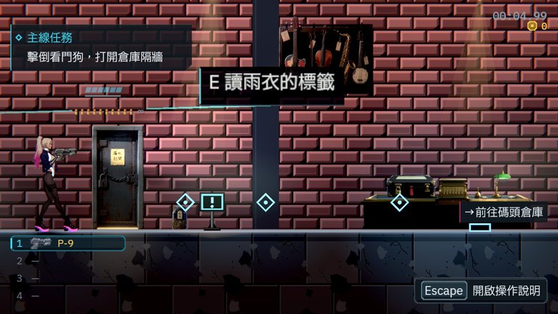

# [NE-348] 重用遊玩中的跨區路線

> 狀態：完成

## 內文

### 需求

相同的跨區目標在玩家移動時持續指向正確出口。玩家只移動或鏡頭變化時，導引不重複搜尋同一條路線。門鎖或任務改變時重新指路。

### 來源

2026-11-25 續作 NE-223。程式檢查發現跨區指引每畫格搜尋一次，即使玩家停留在同一區。

### 驗收條件

- [x] 同一地點、目標及旗標下連續取樣只搜尋一次。無路線時也適用。
- [x] 開門旗標、還原旗標或更換目標後更新指引。實際出口文字、避讓與 Hover 保持正常。

### 測試流程

1. 從正式當舖顯示前往碼頭倉庫的目標，核對方向及下一個出口。
2. 用回歸測試觀察重複更新、旗標事件、旗標還原及更換目的地。

---

# 跟其他票的關係

- Blocks：無
- Blocked by：無
- Related：NE-223、NE-343

# Commit-1

當舖的正式跨區導引連續更新 120 次。RX 9070 XT Forward+ 對照中，搜尋從 120 次降到 1 次。目標仍是碼頭倉庫，Hover 仍說明下一個出口通往港區街道。

受影響測試執行 11,586 項。高併發的拾取紀錄逾時檢查獨立重跑 236 項全過，其他分片通過。任務套件亦驗證負結果、旗標變更和整份還原。

