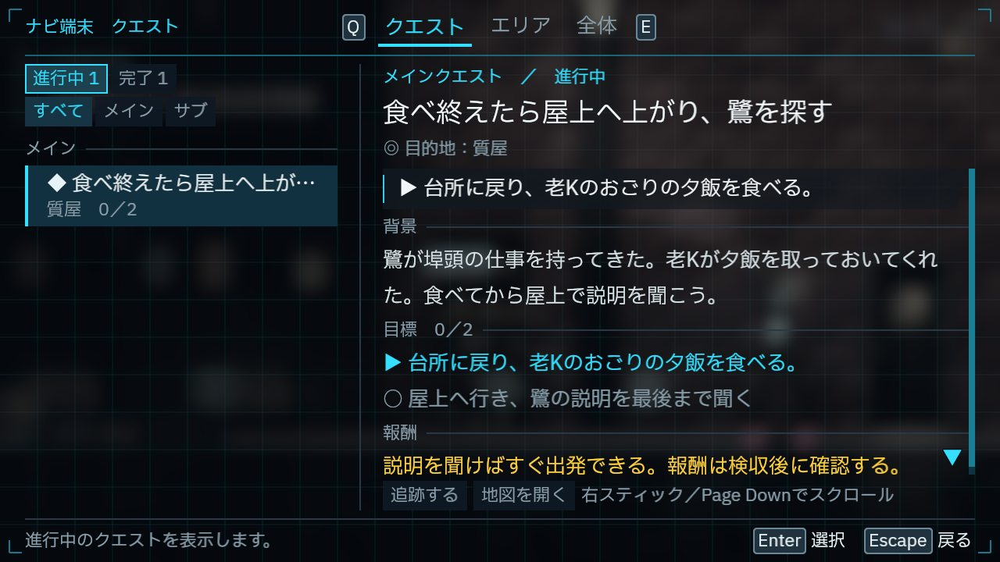

# [NE-351] 修正切換字型後的字形繪製錯誤

> 狀態：完成

## 內文

### 需求

已開啟的介面切換語言或字型樣式後，保留繪圖佇列仍需要的字形，切回原樣式應直接重用字型。

### 來源

2026-11-25 [Linux CI 任務地圖片段](https://github.com/deadline314/Nest-Egg/actions/runs/45511598171) 的斷言全過，繪製字形時記錄已釋放資源錯誤。

### 驗收條件

- [x] 已排版的日文字形保留至切換完畢，回到日文平滑樣式時重用快取。
- [x] 平滑與像素樣式、內文與標題的備援及文字縮放維持原有行為。
- [x] 受影響套件全過。

### 測試流程

在任務目錄開著時依序切換繁中、日文、英文及像素樣式，再切回日文平滑樣式。回歸個案保存排版時使用的字形並檢查切換後仍有效。

---

# 跟其他票的關係

- Blocks：無
- Blocked by：無
- Related：NE-223、NE-228

# Commit-1

固定保留有使用的內文字型與標題備援；換語言或樣式時只更新既有字型介面的底層資源。以新增的四項檢查回跑舊版，兩項失敗；Windows 受影響範圍 60 組、65,616 項通過。RX 9070 XT Forward+ 核對既有任務目錄中、日、英切換，720p、120% 文字。

