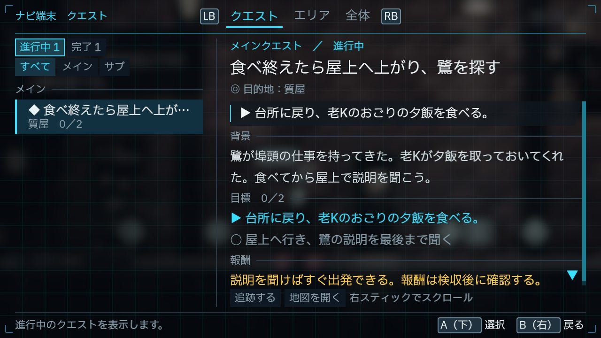

# [NE-352] 讓任務內文捲動提示跟隨輸入裝置

> 狀態：完成

## 內文

### 需求

任務細節需要捲動時，操作列顯示目前裝置的可用操作。改用鍵盤或手把時保留操作焦點。

### 來源

2026-11-25 任務目錄原生驗收。原提示同時顯示右搖桿與 Page Down，缺少往上讀的鍵盤操作。

### 驗收條件

- [x] 鍵盤顯示 PgUp、PgDn，手把顯示右搖桿。
- [x] 捲動或切換提示時焦點保留，短內容沿用原有隱藏條件。
- [x] 受影響套件全過。

### 測試流程

開啟有長篇背景的任務，送出 PgDn、右搖桿及 PgUp。確認捲動方向與說明，焦點留在原按鈕。

---

# 跟其他票的關係

- Blocks：無
- Blocked by：無
- Related：NE-223、NE-228、NE-229

# Commit-1

沿用輸入綁定通知更新提示，移除裝置切換時重複的刷新。舊版在新回歸的 557 項中有 3 項失敗，修正後全過。受影響範圍 16 組、9,576 項通過。RX 9070 XT Forward+ 以日文、720p、120% 字級驗證鍵盤與合成手把切換。

