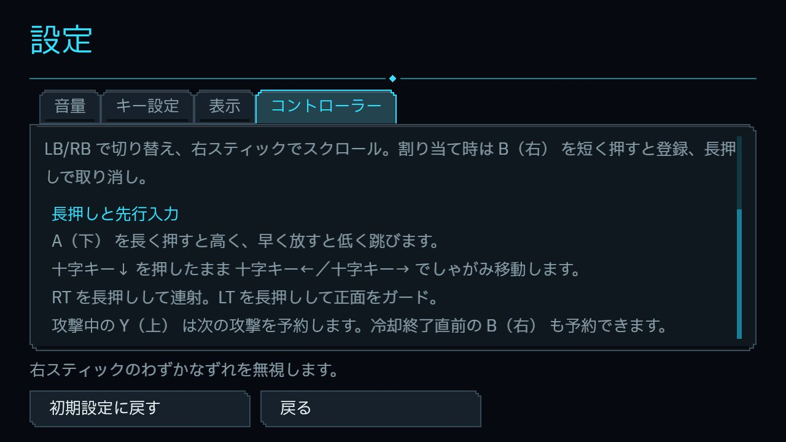

# [NE-353] 統一設定與任務的捲動提示

> 狀態：完成

## 內文

### 需求

在手把設定用目前裝置的捲動提示。與任務內文共用繁中、日文和英文說明，保留分頁與改鍵資訊。

### 來源

2026-11-25 檢查相似介面。手把設定一直同時列出兩種裝置的捲動方式。

### 驗收條件

- [x] 進入手把設定後，切換裝置立即顯示對應的捲動說明。
- [x] 保留分頁鍵、短按綁定、長按取消，以及原操作焦點。
- [x] 受影響套件全過。

### 測試流程

開啟設定，先用鍵鼠操作，再用手把切換到手把頁，最後切回鍵鼠。觀察捲動說明，確認現有改鍵操作可用。

---

# 跟其他票的關係

- Blocks：無
- Blocked by：無
- Related：NE-228、NE-229、NE-352

# Commit-1

設定和任務共用捲動說明，沿用按鍵通知更新。舊版 821 項有 3 項失敗，修正後設定與任務焦點回歸全過。受影響範圍 34 組、17,171 項通過。RX 9070 XT Forward+ 另以日文、720p、120% 文字驗證合成切換及版面。

