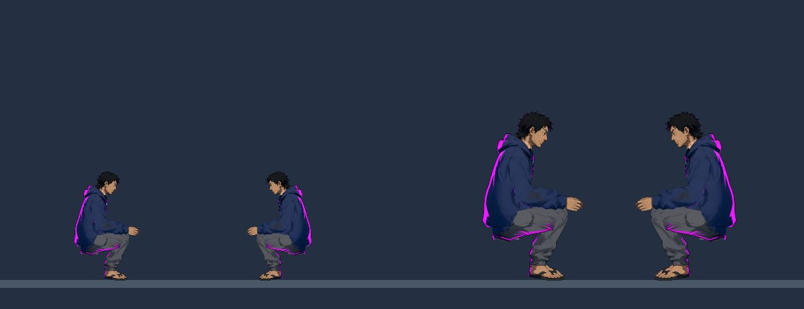
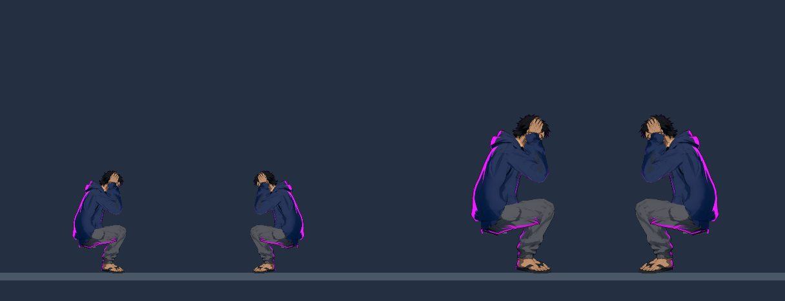

# [NE-354] 讓 NPC 在連續聲響後維持抱頭

> 狀態：完成

## 內文

### 需求

連續槍聲或爆炸讓 NPC 蹲下抱頭後，直到周圍安靜才放手起身。手勢須接回原姿勢與工作。

### 來源

2026-11-25 核對 NPC 抱頭動作與連續聲響。住戶在最後一聲後尚未達到安靜門檻時雙手已放下。

### 驗收條件

- [x] 連續聲響更新等待時間，左右面向抱頭都會持續到安靜後。
- [x] 同一場景的住戶恢復原姿勢，原有工作循環及其他指定手勢通過回歸。
- [x] 受影響套件與骨架檢查通過。

### 測試流程

讓正式住戶在一段槍聲後蹲下，再於 1.75 與約 2.63 秒送出兩次聲響。檢查第 320 影格仍護頭，第 420 影格已起身。用 2.2 倍與 3.4 倍檢視雙面向。

---

# 跟其他票的關係

- Blocks：無
- Blocked by：無
- Related：NE-240、NE-250

# Commit-1

場景反應接管抱頭手勢的放手時機。住戶在同一測試影格的抱頭權重由約 0.053 修正為 1.0。RX 9070 XT Forward+ 在兩個倍率與雙面向查看同格畫面，另在住戶原先所在的關卡用世界聲響事件確認聽到聲音、維持及回復。舊版新增檢查 2 項失敗。受影響範圍 38 組、55,341 項通過，另有 7,069 項動作及骨架檢查通過。

