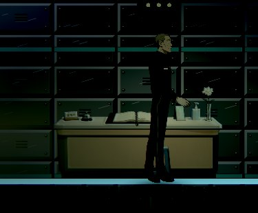

# [NE-355] 讓受驚人物回到正確的劇情姿勢

> 狀態：完成

## 內文

### 需求

NPC 結束抱頭時回到目前劇情決定的姿勢。守門人的站姿或坐姿應依照護進度決定。

### 來源

2026-11-25 核對場景反應的收尾。照護事件前的守門人會在槍聲停止後直接切到照護後的坐姿。

### 驗收條件

- [x] 照護未完成時，守門人結束抱頭後回到站姿。
- [x] 抱頭期間若照護旗標成立，收手後恢復目前劇情的坐姿。
- [x] 受影響套件全過。

### 測試流程

載入守門人資料及正式骨架，從照護前的站姿讓附近響起三聲。分別保留旗標或在抱頭期間改旗標，驗證安靜後的恢復姿勢。另在第三章閘門大廳送出相同的聲響事件。

---

# 跟其他票的關係

- Blocks：無
- Blocked by：無
- Related：NE-240、NE-250、NE-354

# Commit-1

收手時沿用場景初始化所使用的劇情姿勢選擇。舊版 916 項檢查有 1 項失敗，受影響範圍 4 組、3,566 項全過。RX 9070 XT Forward+ 在正式第三章閘門大廳重播事件並確認照護前恢復站姿，畫面裁切至人物周圍。

