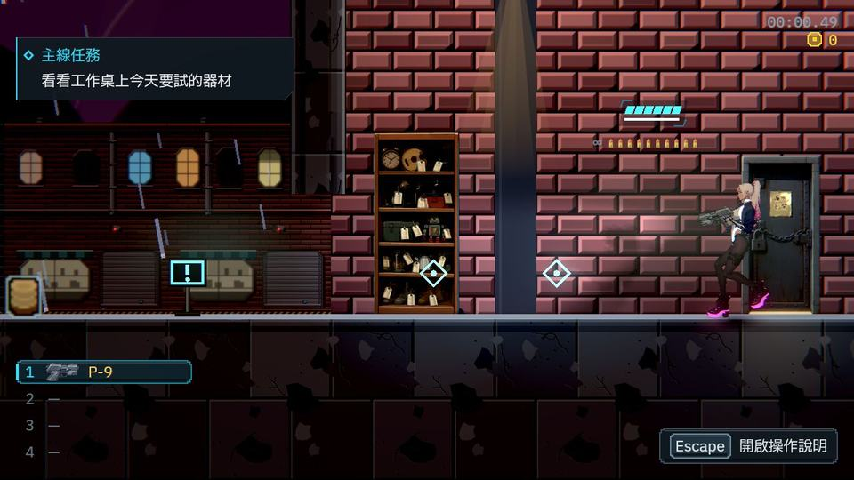

# [NE-356] 分批準備主角貼圖

> 狀態：完成

## 內文

### 需求

降低第一次進區時，玩家骨架一次綁定角色貼圖造成的停頓。詳見[進場設計](../../design/20-campaign-experience/HUD_READING_SPACE.md#分段準備主角貼圖)。

### 來源

使用者回報走到新地方有明顯卡頓。RX 9070 XT Forward+ 量測在第一章當鋪的冷建置重現玩家建立尖峰。

### 驗收條件

- [x] 正式分段進場在建立玩家前分批準備角色已登錄的貼圖。
- [x] 骨架沿用原貼圖、法線與發光資源，建立後由原持有者接手。
- [x] 同場景兩組交替量測都降低當鋪玩家建立的單次耗時。
- [x] 受影響套件全過。

### 測試流程

用正式分段進場冷啟動當鋪與街道。交替測量玩家建立、進場最長影格與可操作後影格，確認移動中主角可見。執行受影響的無頭套件。

---

# 跟其他票的關係

- Blocks：無
- Blocked by：無
- Related：NE-311、NE-321、NE-323

# Commit-1

| RX 9070 XT Forward+，720p | 修前 | 修後 |
| --- | ---: | ---: |
| 當鋪玩家建立，第 1 組 | 176.09 ms | 36.92 ms |
| 當鋪玩家建立，第 2 組 | 205.10 ms | 41.14 ms |
| 當鋪進場最長影格，第 1 組 | 209.3 ms | 205.2 ms |
| 當鋪進場最長影格，第 2 組 | 248.2 ms | 245.7 ms |
| 當鋪整段進場，第 1 組 | 1468.7 ms | 1498.9 ms |
| 當鋪整段進場，第 2 組 | 1702.4 ms | 1743.1 ms |

兩組修後皆先分批讀取貼圖，整段進場多約 30–41 ms。其餘進場尖峰仍待處理。修後另跑當鋪、街道與倉庫，三處可操作後均未出現超過 33.3 ms 的取樣影格。

受影響測試 82 組、102,321 項通過，0 新失敗、0 已知失敗、0 未預期的腳本錯誤。

