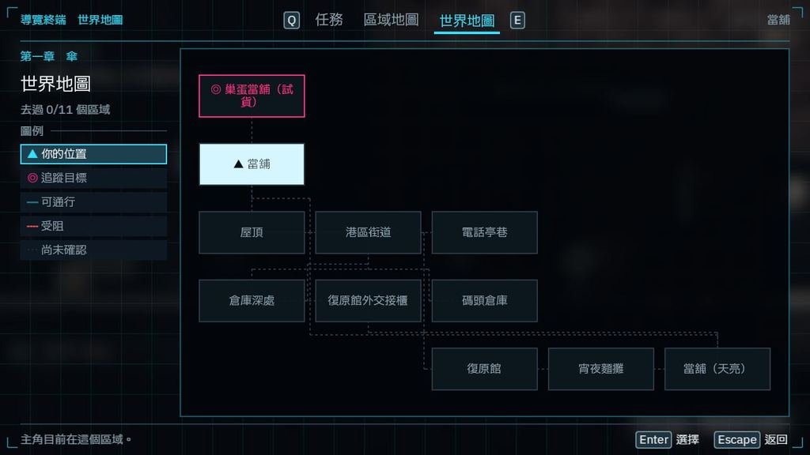

# [NE-357] 將導覽資料與關卡資源分開

> 狀態：完成

## 內文

### 需求

第一次建立章節導覽時，只載入任務、地圖和互動標記需要的資料。查閱路線時保留原有地形、方向、門鎖和顯示內容。詳見[進場設計](../../design/20-campaign-experience/HUD_READING_SPACE.md#即時導覽讀取所需資料)。

### 來源

使用者回報進區停頓。原生量測顯示，在當鋪建立導覽時會同步編譯碼頭倉庫頭目的腳本；市集和泵室也有同類尖峰。

### 驗收條件

- [x] 建立導覽不觸發倉庫頭目腳本載入。
- [x] 三章地形、區域順序、檢查點和互動標記與完整關卡一致。
- [x] 索引生成可檢查是否跟上關卡來源，無效時可回到完整關卡解析。
- [x] 冷建置進場尖峰下降，並觀察走動後及相鄰關卡的影格。
- [x] 受影響測試通過。

### 測試流程

生產地圖索引並執行 `build_level_index.tscn -- --check`。在正式當鋪打開世界地圖並檢查倉庫頭目腳本未載入。故意提供無效的索引版本，確認完整資料能重建當前章節。原生交替量測當鋪、市集、泵室 4 秒走動樣本，另以冷啟動跑街道與倉庫。

---

# 跟其他票的關係

- Blocks：無
- Blocked by：無
- Related：NE-223、NE-311、NE-321、NE-356

# Commit-1

| RX 9070 XT Forward+ 720p，進場最長影格 | 第 1 組修前 | 第 1 組修後 | 第 2 組修前 | 第 2 組修後 |
| --- | ---: | ---: | ---: | ---: |
| 當鋪 | 251.8 ms | 217.7 ms | 252.2 ms | 230.4 ms |
| 市集 | 144.8 ms | 84.2 ms | 147.3 ms | 93.8 ms |
| 泵室 | 166.6 ms | 96.9 ms | 156.9 ms | 114.8 ms |

這三處在可操作後的穩定取樣都沒有超過 33.3 ms 的影格。冷啟動街道後，街道與倉庫的暖機期間最長影格分別為 27.1 ms、10.5 ms。市集剛進區約 70 ms 的暖機尖峰仍在。正式世界地圖可呈現 11 個區域，當下倉庫頭目腳本尚未載入。

受影響測試 26 組、12,582 項通過，0 新失敗、0 已知失敗、0 未預期腳本錯誤。索引的生成檢查通過 32 個區域，寫入格式版本後再跑任務地圖 769 項全過。無效版本可用原路徑重建第一章 11 個區域。

