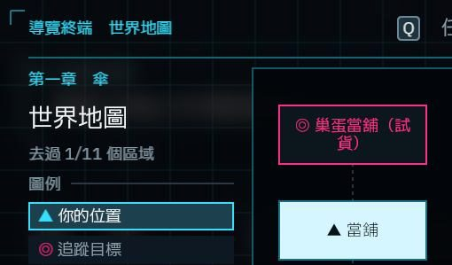

# [NE-359] 進場後立即更新地圖造訪

> 狀態：完成

## 內文

### 需求

玩家剛進入正式區域並打開地圖時，世界地圖應把目前區域計入已造訪，區域地圖應更新腳下與附近可見格位。詳見[任務地圖設計](../../design/18-quest-map-ux/DESIGN.md#進區後的第一張地圖)。

### 來源

在 NE-357 的實機擷取中，當鋪已標明目前位置，立即開圖的造訪數仍顯示 0/11。

### 驗收條件

- [x] 建置完成後立即開圖，能看到腳下的位置已探索。
- [x] 第一章世界地圖立即顯示已造訪當鋪。
- [x] 隱藏的任務預熱不會更新探索，受影響測試全過。

### 測試流程

從新遊戲狀態載入正式當鋪，不等待下一輪定期取樣就開啟地圖。檢查區域格位、目前位置與第一章已造訪數。執行原生擷取與受影響測試。

---

# 跟其他票的關係

- Blocks：無
- Blocked by：無
- Related：NE-223、NE-357

# Commit-1

在 RX 9070 XT Forward+，建置完成當下開第一章世界地圖，造訪數由 0/11 修正為 1/11。角色所在的起始格已探索，其他區域仍依正式探索規則顯示。

受影響測試 67 組、91,319 項全過，0 新失敗、0 已知失敗、0 未預期腳本錯誤。任務地圖套件覆蓋首次開圖、預熱不改探索、返回順序及重開新遊戲。

[修前原生畫面](images/NE-357-world-map.jpg)

