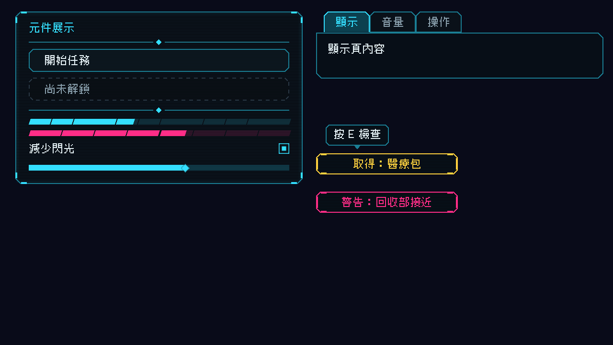
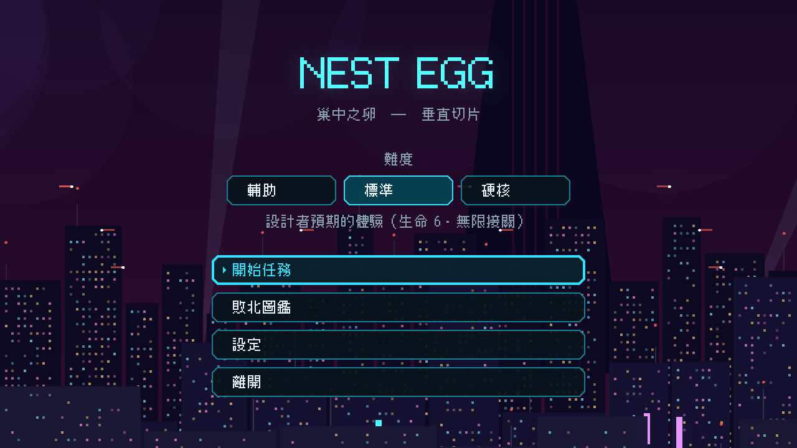
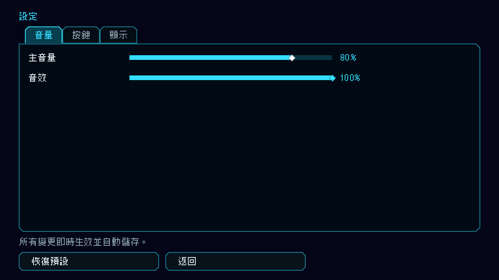
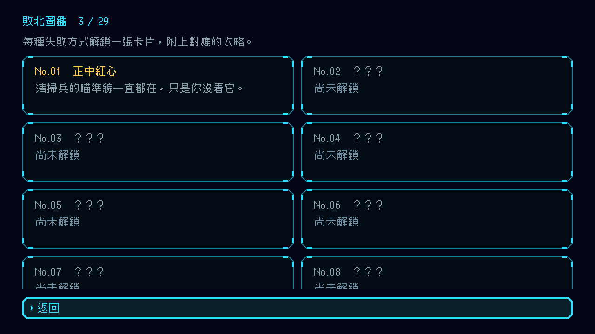
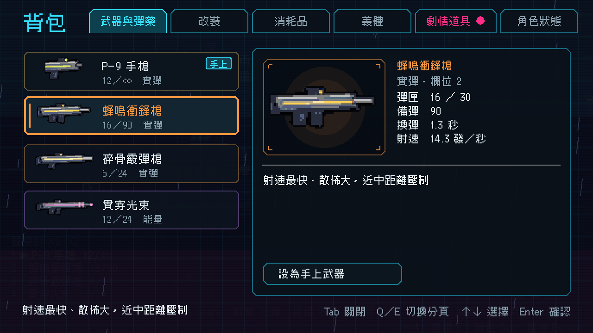

# [NE-35] 建立介面視覺風格與共用元件

> 狀態：完成

## 內文

### 需求
現在的介面是預設主題加系統字型，每個畫面像除錯面板。需要統一的字體、色彩、形狀與動效，以及共用的面板、按鈕、頁籤、條、提示框與橫幅。

### 來源
2026-10-03，使用者於開發對話中提出：「也設計一個好看合適的UI，現在的設計都太簡略了」；「這些都可以去看看目前業界有哪一些最佳實例可以參考，我們盡可能設計的貼近完整實際的 Demo」。設計見 `design/10-presentation/DESIGN.md`、`design/04-story/`。

### 驗收條件
- [x] 全專案採用同一套字體與字級，字體附授權文件；缺字或載入失敗時退回系統字型，不顯示方塊
- [x] 提供統一的面板、按鈕、頁籤、分段條、提示框、橫幅元件，風格一致（切角、青色線條、淡淡的掃描線）
- [x] 每個互動元件都有選取、確認、禁用三種狀態的視覺回饋，選取與確認有音效
- [x] 色彩與字級集中定義，新增畫面不需要重新挑選
- [x] 既有畫面套用後文字不被切斷、排版不跑掉（逐畫面截圖確認）

### 測試流程
1. 逐一開啟主選單、設定、暫停、背包、圖鑑、結算，確認風格一致且文字完整
2. 用滑鼠與鍵盤操作每種元件，確認選取、確認、禁用的回饋
3. 刻意讓字體載入失敗，確認有退路
4. 執行完整測試套件，全部通過

---

# 跟其他票的關係

- Blocks：NE-36、NE-38、NE-43
- Blocked by：無
- Related：NE-16、NE-25

---

# Commit-1

## 內文

原本的介面是預設主題加系統字型，每個畫面像除錯面板。
現在全專案使用同一套像素字體（附授權文件，載入失敗時退回系統字型，缺字也有備援），字級只有內文、標題、大標三種。面板、按鈕、頁籤、橫幅、提示框、滑桿、勾選框都改成切角外框、青色細線、淡淡掃描線與角落小括號；按鈕選取時滑出小三角、確認時閃一下、禁用時改虛線；分段條掉血時有殘影；色彩集中在色票。既有的主選單、設定、圖鑑、背包都已套用，背包頁尾的操作說明因字級統一而被切斷，已加寬。
逐畫面截圖確認文字完整；新增介面元件測試套件，並讓測試可用 --only 只跑單一套件。

### 測試結果

| 項目 | 結果 |
|---|---|
| 完整測試套件 | 通過 1678 / 1678 |
| 資料驗證 | 0 錯誤 |
| 執行 log | 無 ERROR |

### 截圖

