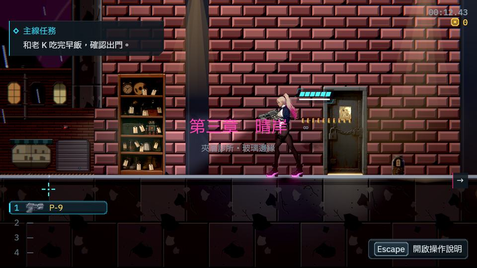

# [NE-360] 遮罩後驗證換區目的地

> 狀態：完成

## 內文

### 需求

玩家走進出口時，先播放轉場，遮住畫面後讀取並驗證目的地資源。目的地無效時恢復原區和原保存資料。詳見[關卡載入效能](../../design/20-campaign-experience/LEVEL_ENTRY_PERFORMANCE.md#出入口驗證)。

### 來源

重播正式街道與倉庫出口，發現出口回呼在轉場前由主執行緒載入冷目的地，最長影格超過 90 ms。

### 驗收條件

- [x] 目的地完整載入在轉場遮住畫面後執行。
- [x] 正式街道與倉庫兩輪原生對照的遮罩前長影格下降。
- [x] 拒絕無效目的地時，原區可繼續操作，存檔和承接狀態保留。
- [x] 受影響測試通過。

### 測試流程

由正式 Main 開新遊戲，使用第一章各區域實際出入口，量轉場開始到遮罩完成的影格。之後使用章末測試位置檢查進入第二、三章。另提供存在但不屬於有效關卡的目的地，核對存檔內容、攜帶狀態、原區操作及提示。

---

# 跟其他票的關係

- Blocks：無
- Blocked by：無
- Related：NE-311、NE-356、NE-357、NE-358

# Commit-1

| RX 9070 XT Forward+，720p，遮罩前最長影格 | 第 1 組修前 | 第 1 組修後 | 第 2 組修前 | 第 2 組修後 |
| --- | ---: | ---: | ---: | ---: |
| 前往街道 | 93.3 ms | 14.3 ms | 108.2 ms | 12.4 ms |
| 前往倉庫 | 189.2 ms | 8.5 ms | 208.0 ms | 10.1 ms |

兩輪修後均完成測試路線。遮罩內仍有冷載入耗時。獨立存檔回歸 1,042 項全過，包含無效目的地回退。

受影響測試 67 組、91,327 項通過，0 新失敗、0 已知失敗、0 未預期腳本錯誤。

