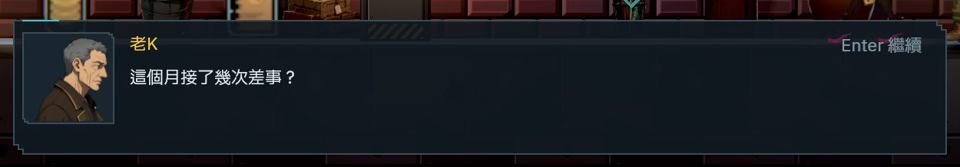

# [NE-362] 沿用對話入口存檔快照

> 狀態：完成

## 內文

### 需求

正在進行的對話保存其已擷取的入口快照，省去重建即將被覆蓋的即時世界資料。從存檔繼續時依舊接回原對話。詳見[關卡載入效能](../../design/20-campaign-experience/LEVEL_ENTRY_PERFORMANCE.md#對話進度保存)。

### 來源

正式 Main 開啟當鋪老 K 的對話時，保存先擷取即時世界，隨後整份替換成對話起點的快照。原生追蹤在對話儲存路徑量到約 17 ms 的多餘擷取成本。

### 驗收條件

- [x] 進行中對話沿用入口快照，開啟和閱讀正常。
- [x] 回歸證明入口不受暫定修改影響，離開對話後仍保存即時世界。
- [x] 原生兩輪對照中，開啟對話的最長影格下降。
- [x] 受影響套件全過。

### 測試流程

正式啟動新遊戲，依目前按鍵綁定靠近老 K 並開啟對話，保留正常逐句閱讀。對照兩版開啟對話時的影格。存檔回歸在取得入口後移動角色，再確認對話快照及之後的即時快照各保留正確位置。

---

# 跟其他票的關係

- Blocks：無
- Blocked by：無
- Related：NE-278、NE-323、NE-361

# Commit-1

| RX 9070 XT Forward+，720p | 修前 | 修後 |
| --- | ---: | ---: |
| 開啟對話的最長影格，第 1 組 | 94.0 ms | 76.4 ms |
| 開啟對話的最長影格，第 2 組 | 84.8 ms | 79.3 ms |

兩輪均正常開啟實際對話。驗證存檔與寫入磁碟仍有成本，對話取消的整輪回復也還會量到較長影格。

舊版在新增回歸的 1,045 項中有兩項失敗，可抓到不必要的重複擷取。修後受影響 9 組、5,289 項全過，0 新失敗、0 已知失敗、0 未預期腳本錯誤。

