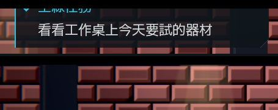

# [NE-363] 讓任務提示避開對話黑邊

> 狀態：完成

## 內文

### 需求

鎖定對話接管畫面時隱藏 HUD 任務列與方向箭頭，收起其 Hover。對話結束後恢復同一個任務目標。詳見[任務地圖設計](../../design/18-quest-map-ux/DESIGN.md#對話接管畫面)。

### 來源

在正式當鋪按互動鍵打開老 K 的對話時，原任務列停在畫面上，標題被上方黑邊裁切。

### 驗收條件

- [x] 老 K 對話以原生畫面重現，修正後上方黑邊沒有截斷的任務字。
- [x] 鎖定期間 HUD 與 Hover 隱藏，離開對話後恢復原目標。
- [x] 受影響套件全過。

### 測試流程

依原流程在當鋪打開老 K 的對話，在同一句出現後擷取上方畫面。用任務地圖套件測試鎖定對話和結束時的目標恢復。

---

# 跟其他票的關係

- Blocks：無
- Blocked by：無
- Related：NE-223、NE-228、NE-362

# Commit-1

RX 9070 XT Forward+ 原生擷取。上圖為修前，任務標題被對話黑邊切到。下圖為修後，對話期間收起任務提示。

其他受影響的 21 組已通過。任務地圖等到 HUD 更新的實際影格後驗證，重跑 806 項全過，0 新失敗、0 已知失敗、0 未預期腳本錯誤。對話結束後已恢復同一目標。

