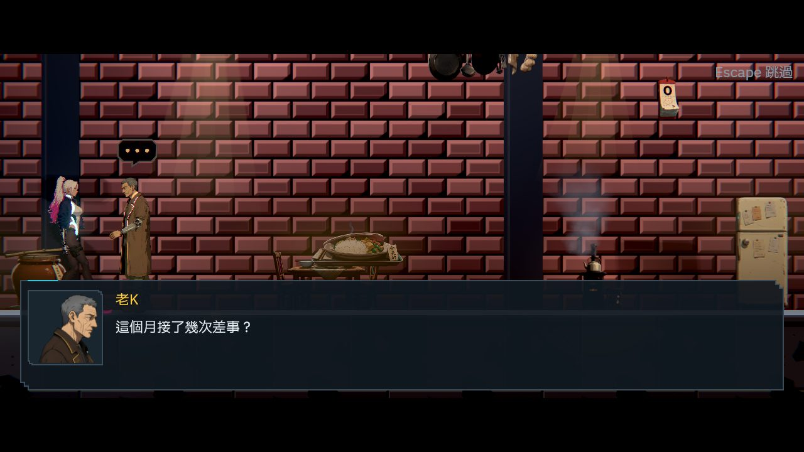

# [NE-365] 消除開關對話時的同步存檔停頓

> 狀態：完成

## 內文

### 需求

讓一般對話開啟、Esc 關閉及中止回復時避開同步整輪寫入。保存中斷續玩和重要劇情結果的一致性。[關卡載入效能](../../design/20-campaign-experience/LEVEL_ENTRY_PERFORMANCE.md#對話進度保存)

### 來源

2026-11-25 試玩回報開啟和取消對話仍明顯停頓。老 K 對話的兩次同步存檔、重複讀取導航版面，以及中止時重建已遊歷區域索引分別出現在追蹤中。

### 驗收條件

- [x] 對話進度只需一次分幀寫入，Esc 關閉仍記存已讀的對話。
- [x] 中止時還原釘選、探索、復原點與現場。讀入舊檔照常驗證及遷移。
- [x] 過期的對話暫存不覆蓋關閉後的檔案，正式結果及退出保存仍有效。
- [x] 在正式當鋪測量開啟、Esc 與主動中止兩條路徑，確認退出後可操控。
- [x] 受影響測試全過。

### 測試流程

以原生 Forward+ 開啟當鋪老 K 對話並分別按 Esc 或中止演出，量測顯示影格、輸入鎖與存檔。使用獨立存檔與合成輸入。

---

# 跟其他票的關係

- Blocks：無
- Blocked by：無
- Related：NE-278、NE-323、NE-362、NE-364

# Commit-1

在 RX 9070 XT、Forward+、1280×720 於正式當鋪操作。同一個老 K 對話分別以 Esc 關閉與中止演出。下表為各操作附近的最長渲染影格。

| 路徑 | 修前開啟 | 修後開啟 | 修前退出 | 修後退出 |
| --- | ---: | ---: | ---: | ---: |
| Esc 關閉 | 82.9 ms | 20.7 ms | 83.2 ms | 18.9 ms |
| 中止並回復 | 91.2 ms | 19.9 ms | 136.8 ms | 22.0 ms |

兩輪都開啟正式對話，結束後解除輸入鎖。修前中止時重建導航索引獨占約 53 ms。回歸覆蓋跨章的釘選、探索、復原點與版面版本，並核對存檔排程的實際發布順序。

受影響 27 組測試共 12,995 項通過，0 新失敗、0 已知失敗及 0 未預期腳本錯誤。

