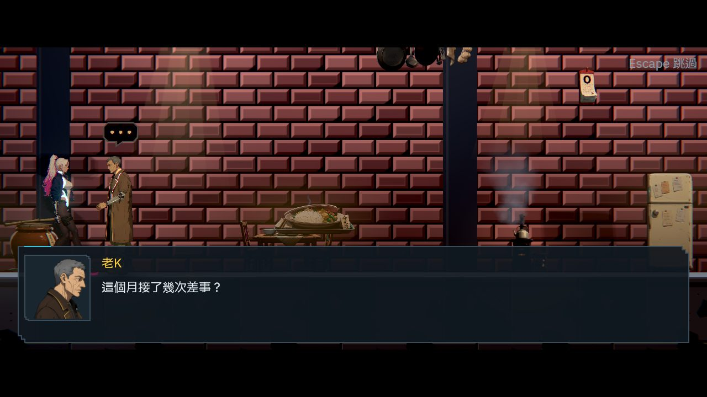
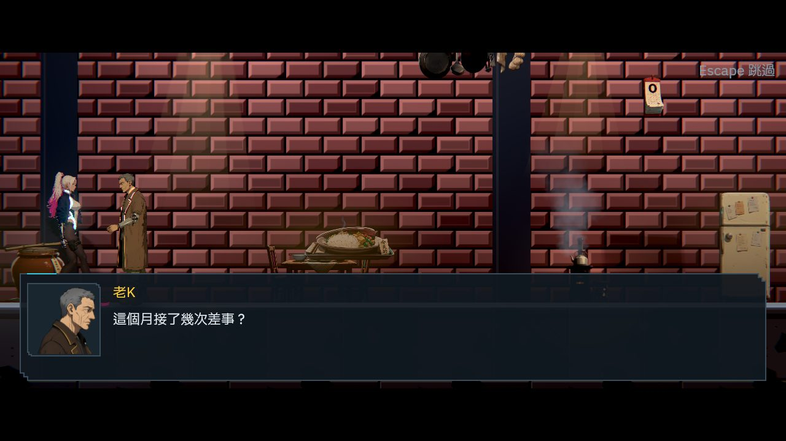

# [NE-366] 交談時收起人物頭頂的未讀提示

> 狀態：完成

## 內文

### 需求

開始正式交談時，收起正在交談人物的未讀泡泡。玩家可以直接從對話框辨識講者。中止第一次交談後，泡泡要立即恢復。[交談時的地圖提示](../../design/20-campaign-experience/INTERACTION_HOLSTER.md#交談時的地圖提示)

### 來源

在 RX 9070 XT 的正式當鋪，開啟老 K 對話後仍可見頭頂的未讀提示，與對話框和講者姓名同時顯示。

### 驗收條件

- [x] 初次交談前有未讀提示，交談中於畫面暫停時也會收起。
- [x] 中止第一次交談後恢復提示，讀完則清除提示。
- [x] 以正式當鋪測試修前與修後，並通過受影響測試。

### 測試流程

使用原生輸入探針在當鋪開啟老 K 對話並中止。核對 NPC 的未讀狀態、對話框及返回後的操作。NPC 套件驗證第一次交談取消後可以重開、完成後記錄已讀。

---

# 跟其他票的關係

- Blocks：無
- Blocked by：無
- Related：NE-228、NE-278、NE-365

# Commit-1

RX 9070 XT、Forward+、1280×720，沿用正式當鋪的對話和輸入鎖。同一個 NPC 在對話出現時收起泡泡。取消或完成時立即重畫。回歸覆蓋未交談、交談中、取消及首次完成。

受影響 59 組、64,999 項檢查全過，0 新失敗、0 已知失敗及 0 未預期腳本錯誤。

| 修前 | 修後 |
| --- | --- |
|  |  |
