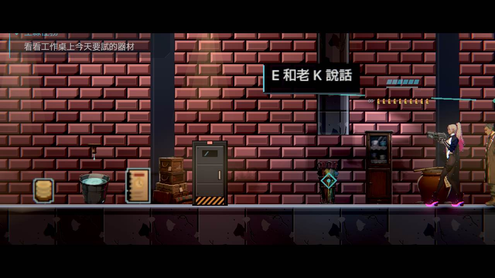

# [NE-368] 減少人物提示的重複繪製

> 狀態：完成

## 內文

### 需求

已交談的人物及開啟減少介面動態時的未讀提示只在畫面需要更新時重畫。未讀泡泡的浮動、物件調查標記及存檔還原必須正常。[交談時的地圖提示](../../design/20-campaign-experience/INTERACTION_HOLSTER.md#交談時的地圖提示)

### 來源

正式當鋪的畫面取樣顯示，老 K 在已讀及減少動態兩種靜態狀態，每 60 個物理影格仍收到 59 次重畫。

### 驗收條件

- [x] 已讀和靜態未讀提示，在畫面穩定後不再逐影格重畫。
- [x] 一般未讀、還原未讀或缺省物件標記仍可識別並更新。
- [x] 正式關卡驗證及受影響測試通過。

### 測試流程

在正式當鋪對同一 NPC 計數未讀、減少動態、已讀及還原未讀四種狀態的繪製。核對懷錶標籤仍更新其調查標記。

---

# 跟其他票的關係

- Blocks：無
- Blocked by：無
- Related：NE-250、NE-366

# Commit-1

RX 9070 XT Forward+，用正式當鋪的老 K 按每 60 個物理影格計數。已讀和減少動態各從 59 次降至 0。正常未讀與還原未讀各保持 59 次。懷錶調查標記也持續更新。

受影響 59 組、64,998 項檢查全過，0 新失敗、0 已知失敗及 0 未預期腳本錯誤。

