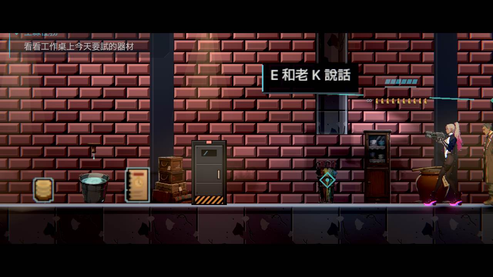
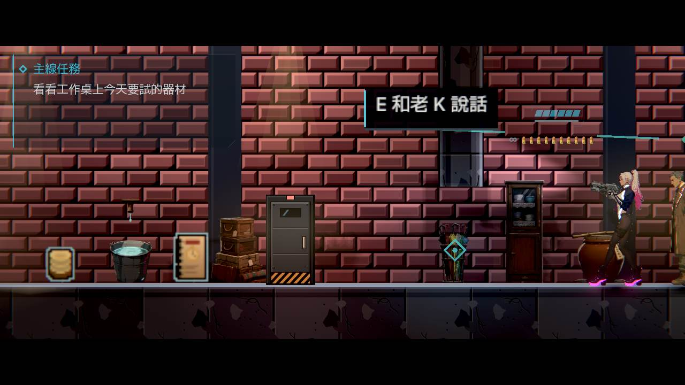

# [NE-369] 讓任務指引避開靠近時的黑邊

> 狀態：完成

## 內文

### 需求

靠近人物時，遊戲仍可操控。任務列和路線箭頭要保持在預覽畫幅內，離開後回到原位置。鎖定對話及通訊仍優先取得畫面。[任務地圖設計](../../design/18-quest-map-ux/DESIGN.md#對話接管畫面)

### 來源

正式當鋪接近老 K，還未按互動鍵時，原任務列的標題已被預覽黑邊切掉。

### 驗收條件

- [x] 接近老 K 時，任務列的標題、內容與邊框在安全畫幅內。
- [x] 離開預覽回到原位置。鎖定對話和通訊期間，任務提示與 Hover 照常讓位。
- [x] 原生畫面與受影響的測試通過。

### 測試流程

在正式當鋪走近老 K，觀察上方黑邊展開時的任務列。離開、開啟對話及中止，核對任務內容、位置及 Hover。

---

# 跟其他票的關係

- Blocks：無
- Blocked by：無
- Related：NE-223、NE-228、NE-363

# Commit-1

RX 9070 XT Forward+，走近正式當鋪的老 K，畫面仍可操作。黑邊高約 43 個邏輯像素時，任務列上緣由第 28 像素移到第 51 像素，標題、內容與框邊都在畫幅內。離開預覽恢復原位置。受影響 22 組、11,906 項通過。

| 修前 | 修後 |
| --- | --- |
|  |  |
