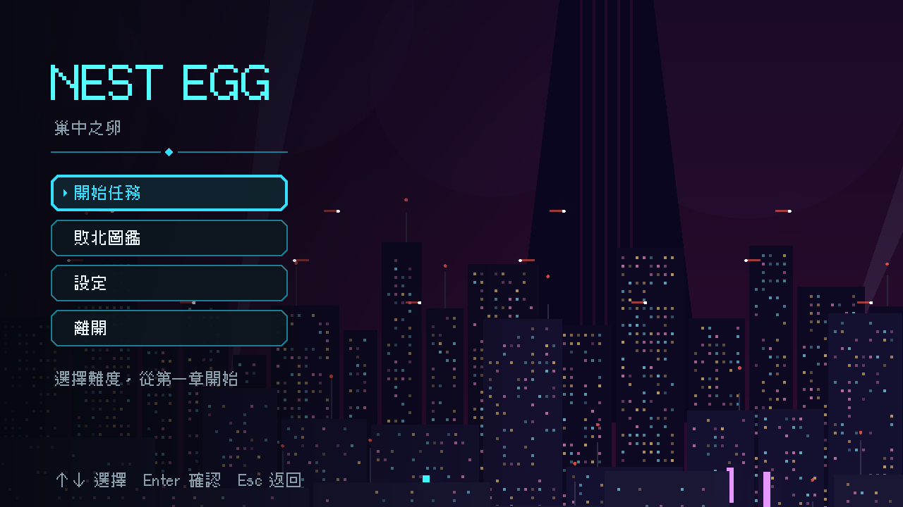
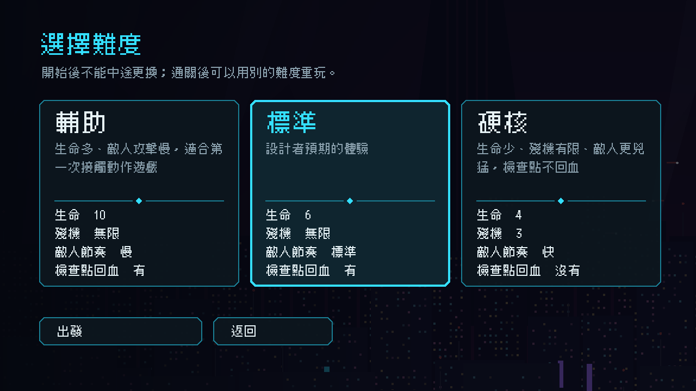
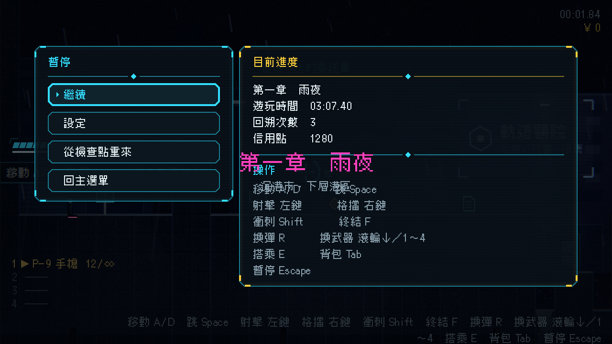
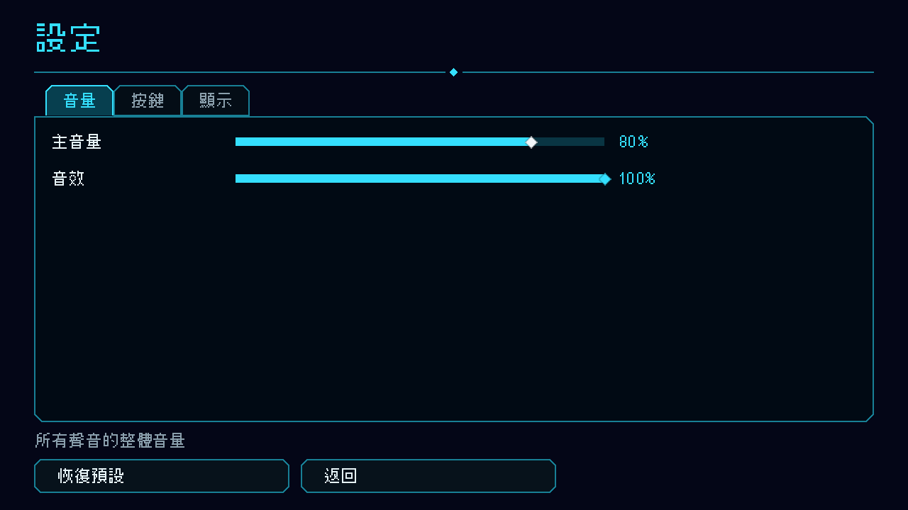
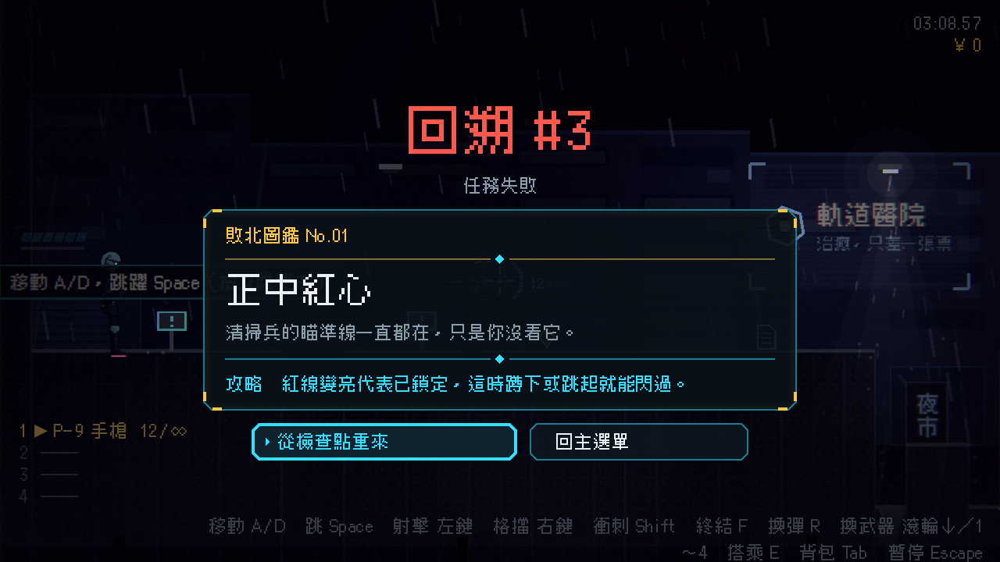
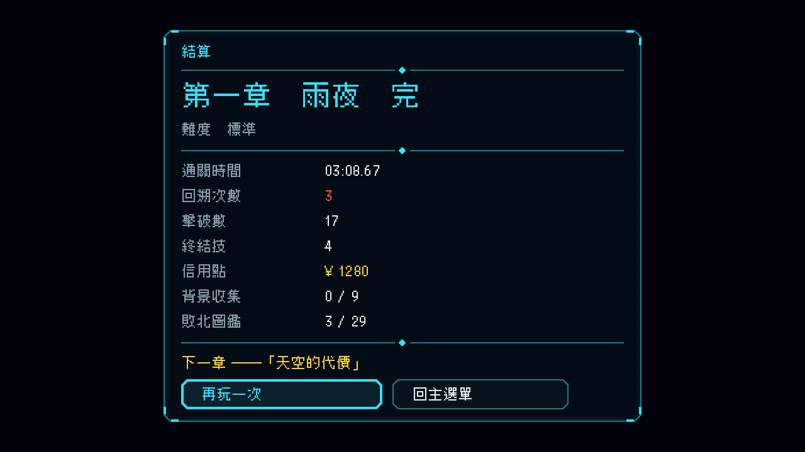
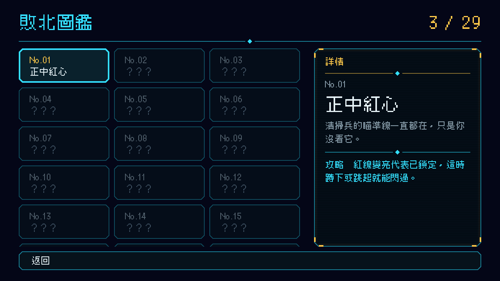

# [NE-36] 改版主選單、暫停、設定、死亡與結算畫面

> 狀態：完成

## 內文

### 需求
主選單、難度選擇、暫停、設定、死亡與結算畫面都太簡略，沒有動態、沒有資訊層次。需要依新的視覺風格重新設計，並加入動態與反饋。

### 來源
2026-10-03，使用者於開發對話中提出：「也設計一個好看合適的UI，現在的設計都太簡略了」；「幫我設計一些動畫跟轉場進去，還有過場動畫，就交給你設計了，發揮你的想像力」；「這些都可以去看看目前業界有哪一些最佳實例可以參考，我們盡可能設計的貼近完整實際的 Demo」。設計見 `design/10-presentation/DESIGN.md`、`design/04-story/`。

### 驗收條件
- [x] 主選單有循環的雨夜背景與依序滑入的選單項目，選單項目有說明
- [x] 難度選擇是三張卡片，各有一句說明與受影響的數值
- [x] 暫停選單顯示目前章節、遊玩時間、死亡次數、信用點與操作說明
- [x] 設定畫面分頁整理，滑桿與勾選套用新元件，每項有一句說明
- [x] 死亡畫面有雜訊進入、回溯編號與展開的敗北圖鑑卡片，重來與回主選單
- [x] 結算畫面各項評價依序跳出，包含收集進度、信用點、敗北圖鑑與下一章預告
- [x] 敗北圖鑑是卡片牆，未解鎖的是剪影，選取時顯示詳情
- [x] 滑鼠、鍵盤與手把都能操作每個畫面

### 測試流程
1. 從主選單走到每一個畫面，確認動態與資訊正確
2. 死亡一次，確認死亡畫面與重來
3. 通關，確認結算畫面
4. 執行完整測試套件，全部通過

---

# 跟其他票的關係

- Blocks：無
- Blocked by：NE-35、NE-37
- Related：NE-37、NE-51

---

# Commit-1

## 內文

原本的主選單、暫停、死亡、結算畫面都是方框加文字，沒有層次也沒有動態。
現在主選單背景是緩慢搖鏡的雨夜沉港，標題與選項依序滑入，游標或焦點移到選項時下方顯示一句說明；開始任務後進入三張難度卡片，各有說明與生命、殘機、敵人節奏、檢查點回血。暫停畫面左側是選單、右側顯示章節、遊玩時間、回溯次數、信用點與操作說明。設定畫面套用新元件，每個控制項的說明在游標或焦點到達時顯示在底部。死亡畫面以雜訊溶解進入，標題是「回溯 #n」，敗北圖鑑卡片像檔案一樣展開；結算畫面各項評價依序跳出（按確認鍵可立刻全部顯示），包含信用點、背景收集、敗北圖鑑與下一章預告。敗北圖鑑改成卡片牆，未解鎖是剪影，選取時右側顯示詳情。所有畫面都用焦點導覽，滑鼠、鍵盤、手把皆可操作。
驗收：新增介面畫面測試套件（難度卡片決定開始難度、取消鍵返回、圖鑑剪影不洩漏內容、暫停資訊、死亡卡片缺欄位容錯、結算略過逐項顯示），並逐畫面截圖確認文字完整。

### 測試結果

| 項目 | 結果 |
|---|---|
| 完整測試套件 | 通過 1728 / 1728 |
| 資料驗證 | 0 錯誤 |
| 執行 log | 無 ERROR |

### 截圖

