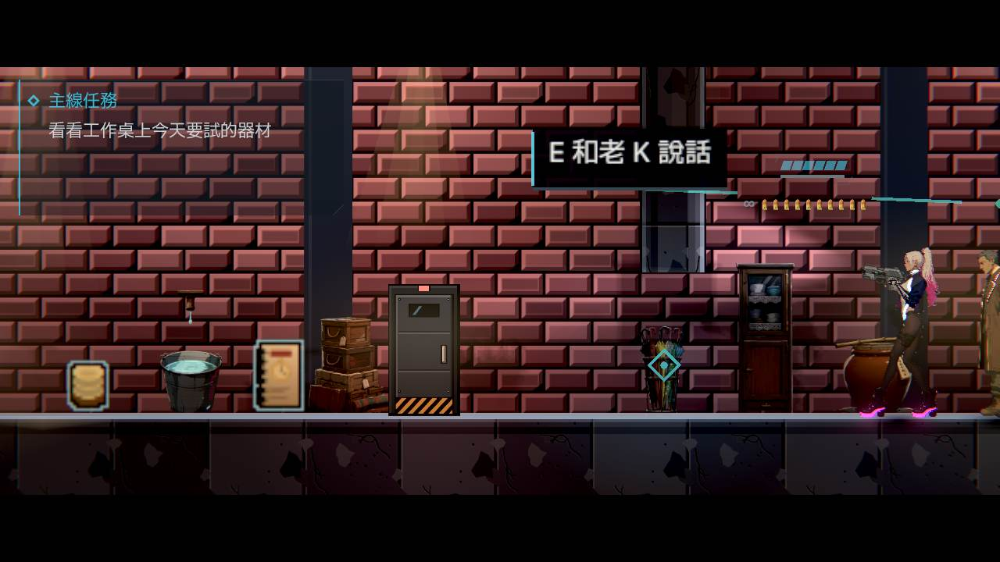
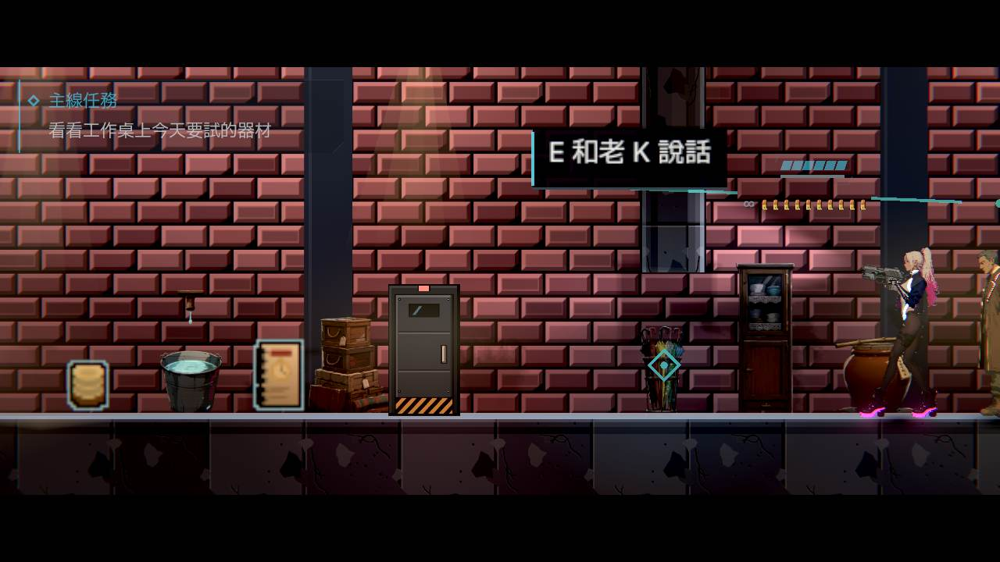

# [NE-370] 收合任務提示框的多餘高度

> 狀態：完成

## 內文

### 需求

任務提示按標題與當前步驟所用的高度貼合內容。短目標收回舊的空白，長目標保留換行及 Hover 閱讀。[任務地圖設計](../../design/18-quest-map-ux/DESIGN.md#14-遊玩中的任務欄)

### 來源

正式當鋪的任務列只有一行內容，舊框仍占 87 個邏輯像素高，同一份文字實際只需要 47 像素。

### 驗收條件

- [x] 從多行目標改成一行時，提示框收回空白並保留原閱讀寬度。
- [x] 正式當鋪的短目標完整可讀，框邊貼合可見內容。
- [x] 受影響測試通過。

### 測試流程

在正式當鋪核對任務列的高度與文字。再用多行目標換回短目標，確認框高會縮回，而且保留原排版寬度。

---

# 跟其他票的關係

- Blocks：無
- Blocked by：無
- Related：NE-223、NE-228、NE-369

# Commit-1

RX 9070 XT Forward+ 的原生當鋪畫面上，對同一個短目標，框高從 87 降到 47 個邏輯像素，寬度維持 208。修前的原生檢查能抓到多餘空白。回歸另驗證多行切成一行時的框高與寬度。受影響 22 組、11,908 項全過。

| 修前 | 修後 |
| --- | --- |
|  |  |
