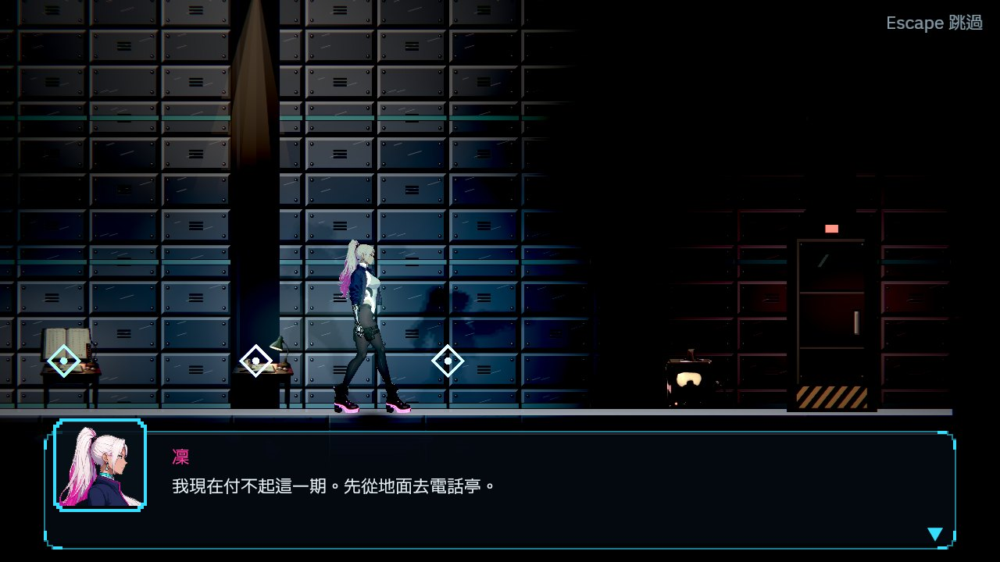

# [NE-377] 修正故事付款不足後的重試

> 狀態：完成

## 內文

### 需求

玩家看完餘額不足的回覆後，可以再問或等有足夠信用點再付款。原付款的收據與通行條件應在真正付款後才生效。

### 來源

第五章灰道小桌的付款流程驗收發現。第一章麵攤使用同一付款流程。

### 驗收條件

- [x] 餘額不足時可連續嘗試兩次，替代回覆正常結束，存檔保留未付款。
- [x] 在另一個程序續玩仍可重試，原本錢包、物品、收據與通行狀態維持原值。
- [x] 補足款項後只扣一次，真正保存遭拒時可從提示重試。
- [x] 舊檔有正式餘額不足的完成紀錄且結果確實尚未產生時，可在原互動續玩。
- [x] 第一章麵攤的餘額不足、保留欠條和正常付款流程可繼續使用。

### 測試流程

1. 以不足的信用點連續嘗試付款兩次，重開後再試一次。檢查門、餘額和收據。
2. 補足信用點並確認付款，讀回存檔並再次查看收據。
3. 續玩曾誤記付款完成的原存檔，再試同一付款來源。
4. 在第一章麵攤分別走餘額不足和正常付款流程。

---

# 跟其他票的關係

- Blocks：ST-47
- Blocked by：無
- Related：NE-376

---

# Commit-1

## 內文

餘額不足的回覆曾把原付款當成已完成，後續會卡在付款。現在替代回覆仍會正常結束，原付款可重試。補足信用點後，扣款、收據和通行在同一次保存生效。舊檔保留原有完成紀錄，經原互動核對到正式拒付和缺少付款結果時也能重試。

### 測試結果

| 項目 | 結果 |
|---|---|
| 受影響的回歸 | 68 組、64,612 項通過，0 新失敗、0 已知失敗 |
| 灰道連續不足、撤銷、保存遭拒後付款及通行 | 通過 62 / 62 |
| 未付款與已付款各自重開 | 通過 27 / 27 |
| 原始舊檔、四項防重付條件及補款後重試 | 通過 15 / 15 |
| 第一章麵攤實際不足及正常付款 | 通過 107 / 107 |
| 過場、地圖對話、第二章劇情及存檔套件 | 通過 3,938 / 3,938 |
| Forward+ 實地確認餘額不足回覆 | 通過 11 / 11 |

### 截圖

