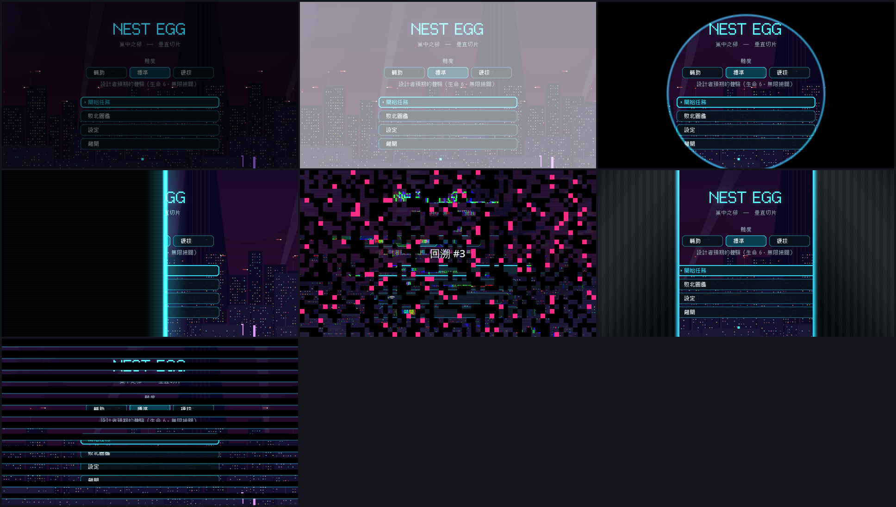
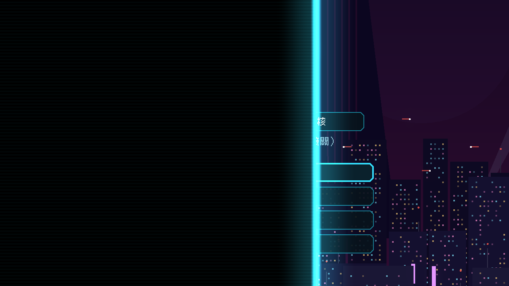

# [NE-37] 加入畫面轉場系統

> 狀態：完成

## 內文

### 需求
畫面切換目前就是直接切，沒有情緒。需要一套轉場（淡入淡出、光圈、掃描線、雜訊溶解、電梯門、百葉），並在適當的地方使用。

### 來源
2026-10-03，使用者於開發對話中提出：「幫我設計一些動畫跟轉場進去，還有過場動畫，就交給你設計了，發揮你的想像力」；「這些都可以去看看目前業界有哪一些最佳實例可以參考，我們盡可能設計的貼近完整實際的 Demo」。設計見 `design/10-presentation/DESIGN.md`、`design/04-story/`。

### 驗收條件
- [x] 有六種轉場：淡入淡出、光圈、掃描線、雜訊溶解、電梯門、百葉
- [x] 轉場期間輸入鎖定，按略過鍵可以縮短
- [x] 主選單進入遊戲、章節切換、死亡重來、從檢查點重生、結算畫面進出都使用合適的轉場
- [x] 死亡重來的轉場不超過 1 秒
- [x] 「減少閃光」開啟時，雜訊與閃白的轉場降級為淡入淡出
- [x] 轉場不造成持續的記憶體增長，也不影響遊戲暫停狀態

### 測試流程
1. 逐一觸發每種轉場，確認外觀與時間
2. 死亡十次，確認不卡、不累積
3. 開啟減少閃光，確認降級
4. 執行完整測試套件，全部通過

---

# 跟其他票的關係

- Blocks：NE-36、NE-38
- Blocked by：無
- Related：NE-24

---

# Commit-1

## 內文

原本畫面切換就是直接切，沒有任何轉場。
現在有獨立的全域轉場服務，提供六種轉場：淡入淡出、光圈、掃描線、雜訊溶解、電梯門、百葉。轉場期間遊戲暫停、輸入鎖定，按任意鍵可加速；結束後還原原本的暫停狀態；轉場進行中再次呼叫不會吞掉畫面切換。開新遊戲與主選單用掃描線、章節切換用電梯門、死亡重來用雜訊溶解並顯示回溯編號（總長 0.7 秒加 0.22 秒停留，不到 1 秒）、從檢查點重來用光圈、結算畫面進出用百葉。「減少閃光」開啟時，雜訊與閃白降級為淡入淡出。
驗收：新增轉場測試套件（六種都完成且只切換一次、暫停還原、加速、重來時間、降級、無節點累積），並用真實流程（主選單開始遊戲）截圖確認掃描線轉場。

### 測試結果

| 項目 | 結果 |
|---|---|
| 完整測試套件 | 通過 1709 / 1709 |
| 資料驗證 | 0 錯誤 |
| 執行 log | 無 ERROR |

### 截圖

