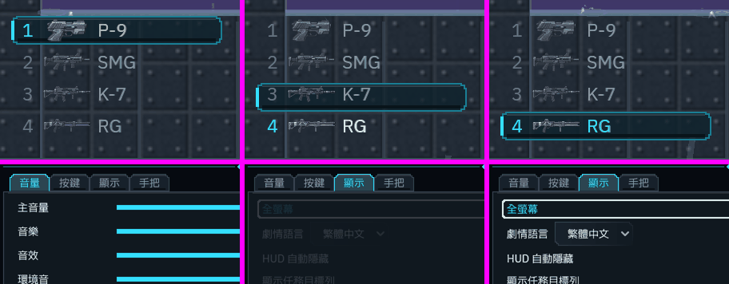

# [NE-389] 讓換武器與切換設定分頁有動效回饋

> 狀態：完成

## 內文

### 需求
換武器時武器列的選取框瞬間跳到新位置，設定頁切分頁是整頁瞬間換內容，操作沒有回饋，介面顯得生硬。這張票補上短促、不擋輸入的過渡。

### 來源
2026-11-27，使用者指出地圖、介面與玩法看起來簡陋死板、圖片像被直接貼上，要求參考業界做法加入動畫與互動、讓物件融入場景，並調整光照、渲染與效能。設計見[畫面活化與融入](../../design/22-living-scenes/DESIGN.md)，研究依據見[研究](../../design/22-living-scenes/RESEARCH.md)。

### 驗收條件
- [x] 換武器時選取框滑到新武器的位置，新武器名稱短暫提亮；120 毫秒內完成
- [x] 設定頁切分頁時新內容短距離滑入並淡入，方向與分頁移動方向一致；150 毫秒內完成
- [x] 動畫期間輸入照常生效；連續快速切換以最後一次為準，不排隊播放、不殘留半透明或位移
- [x] 「減少動態」開啟時全部直接到位
- [x] 鍵鼠與手把操作結果相同；720p 與 1080p 不截字、不重疊
- [x] 附修前修後截圖與動畫中間一格；受影響範圍的測試全過

### 測試流程
1. 在關卡裡連續切換四把武器
2. 預期選取框滑動到位，快速連按時停在最後一把
3. 開設定頁用左右鍵切分頁
4. 預期內容短距離滑入，開啟「減少動態」後直接切換

---

# 跟其他票的關係

- Blocks：無
- Blocked by：無
- Related：NE-228

---

# Commit-1

## 內文

換武器時武器列的選取框瞬間跳到新的一列，設定頁切分頁是整頁瞬間換內容，操作沒有回饋。
現在換武器時選取框滑到新武器那一列（100 毫秒），新武器的名稱短暫提亮再退回原色；設定頁切分頁時新內容從移動的方向短距離滑入並淡入（140 毫秒），往右翻從右邊進來、往左翻從左邊進來。動畫期間輸入照常生效；連續快速切換時從目前的位置滑向最後一次的目標，不排隊也不殘留位移或半透明。「減少動態」開啟時全部直接到位。
原生情境實際切換一次武器與一次分頁，各拍切換前、動畫中間、到位後三格：中間那一格選取框在兩列之間（y=42.2，終點 60）、分頁內容不透明度 0.05，結束時都完全到位。

### 測試結果

| 項目 | 結果 |
|---|---|
| 受影響範圍的測試（25 個套件） | 13627 項檢查，3 項在八個程序平行的負載下失敗一次：近戰連按輸入的計時檢查 2 項、介面橫幅的計時檢查 1 項（都與本票無關）；這兩個套件單獨重跑兩次皆 1232 / 1232 通過 |
| 腳本錯誤 | 0 |
| 原生情境（換武器、切分頁） | 中間格在移動中、結束時到位，無錯誤 |

### 截圖

由左到右：切換前、動畫中間、到位後。上排是武器列（由 P-9 換到 RG），下排是設定頁（由「音量」切到「顯示」）。

