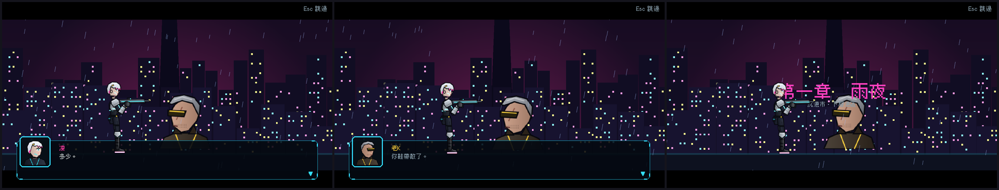

# [NE-38] 建立過場動畫系統

> 狀態：完成

## 內文

### 需求
現在的過場只有黑底、頭像與一行字，沒有畫面與演出。需要一套以資料檔描述的過場動畫：背景場景、鏡頭、角色、台詞、特效、音效、標題卡與轉場。

### 來源
2026-10-03，使用者於開發對話中提出：「幫我設計一些動畫跟轉場進去，還有過場動畫，就交給你設計了，發揮你的想像力」；「這些都可以去看看目前業界有哪一些最佳實例可以參考，我們盡可能設計的貼近完整實際的 Demo」。設計見 `design/10-presentation/DESIGN.md`、`design/04-story/`。

### 驗收條件
- [x] 演出由資料檔描述，不需要改程式就能新增或修改演出
- [x] 支援場景背景、鏡頭推拉搖、角色放置與移動、台詞（含低語、吼叫、雜訊風格）、特效、音效、標題卡、上下黑邊與轉場
- [x] 按略過鍵可跳到結尾；已看過的演出重來不重播；設定可選擇每次都略過
- [x] 演出時遊戲暫停，結束後回到遊戲的狀態與演出前一致
- [x] 演出資料損毀或缺少引用的素材時記錄具體位置並略過，不卡住遊戲
- [x] 有檢查工具驗證所有演出檔：引用的場景、角色、講者與台詞都存在，台詞數不超過上限

### 測試流程
1. 在測試場景播放一段包含所有步驟的演出，確認每個步驟的效果
2. 演出中按略過，確認跳到結尾且遊戲狀態正確
3. 故意放一個壞的演出檔，確認被略過且有錯誤訊息
4. 執行完整測試套件，全部通過

---

# 跟其他票的關係

- Blocks：NE-52、NE-53
- Blocked by：NE-35、NE-37
- Related：NE-34

---

# Commit-1

## 內文

原本的過場只有黑底、頭像與一行字，沒有畫面與演出。
現在演出由資料檔描述：在章節劇本新增 animated 場景，用 scene、camera、actor、move、say、narrate、title、fx、sfx、wait、fade、transition 等步驟組合，場景（舞台）也是資料檔，由漸層、天際線、方塊、多邊形、柔光、圖片、雨、顆粒、文字、警示條紋等圖層組成，支援視差。角色可用遊戲內的骨架外觀（同一套動畫）或頭像剪影。台詞支援低語、吼叫、雜訊三種風格，逐字顯示會在標點停頓。演出時遊戲暫停，Esc 跳到結尾，結束後還原暫停狀態；已看過的演出重來不重播，設定新增「略過過場動畫」。壞掉的步驟只記錄「場景 id 第 n 步」並略過。檢查器驗證場景、角色、講者、音效、轉場是否存在與台詞數量，啟動時與測試都會跑。
驗收：新增過場動畫測試套件（所有步驟播放、跳過、損毀資料容錯、暫停還原、與劇情服務整合、檢查器各類錯誤、全部現有劇本通過檢查），並用雨夜沉港範例場景截圖。

### 測試結果

| 項目 | 結果 |
|---|---|
| 完整測試套件 | 通過 1768 / 1768 |
| 資料驗證 | 0 錯誤 |
| 執行 log | 無 ERROR |

### 截圖

