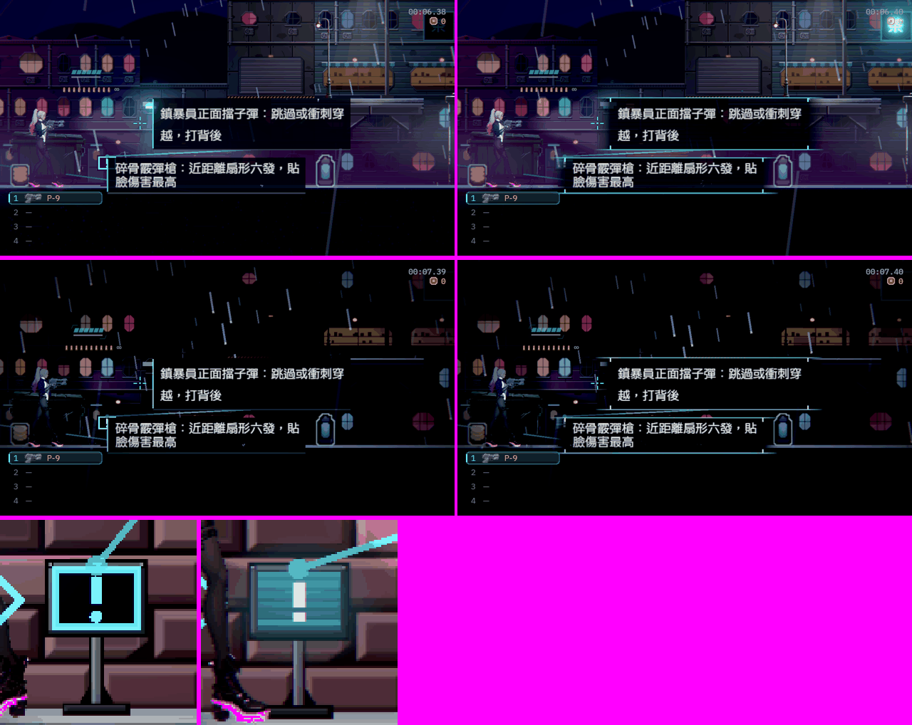

# [NE-390] 把教學看板與世界提示改成全像投影

> 狀態：完成

## 內文

### 需求
教學看板是一個青色方框加驚嘆號，靠近後跳出一整塊黑底方塊蓋在場景上，看起來像除錯用的框，和場景沒有關係。這張票把看板改成真的會亮的顯示器，把提示改成從物件投出來的全像字幕，讓它們像這個世界裡的東西。

### 來源
2026-11-27，使用者貼出教學看板的截圖（青色方框加驚嘆號），指出所有方方框框的東西，不管是介面還是場景裡的，看起來都不精緻，要求更貼合遊戲美術與世界觀。設計見[畫面活化與融入](../../design/22-living-scenes/DESIGN.md)的「方框告示與介面面板」，研究依據見[研究](../../design/22-living-scenes/RESEARCH.md)。

### 驗收條件
- [x] 教學看板的螢幕不再是一圈青色方框：螢幕本身有亮度漸層、掃描線與柔和光暈，圖示有緩慢的動態；暗處仍然找得到
- [x] 世界提示（教學看板、互動物件、載具、檢查點共用）不再是實心黑底方塊：底色兩端淡出、上下是會淡出的細亮線、有掃描線與角標，看起來是投影出來的
- [x] 提示出現時由一條線展開成整片，消失時收回；「減少動態」開啟時直接淡入淡出
- [x] 文字對比不低於修前：在亮場景（霓虹市集）與暗場景（停電）都讀得清楚，附兩個場景的截圖
- [x] 按鍵帽、多行文字、被推開時的指向線、多個提示同時出現時的錯開，行為與修前相同
- [x] 不增加每影格配置；靜止不動的提示不重畫
- [x] 附修前修後同場景截圖；受影響範圍的測試全過

### 測試流程
1. 進第一章街道，走近教學看板
2. 預期看板螢幕像亮著的顯示器，提示由一條線展開成全像字幕，沒有實心黑方塊
3. 走近兩個相鄰的看板，預期兩則提示錯開不重疊
4. 開啟「減少動態」，預期提示直接淡入

---

# 跟其他票的關係

- Blocks：無
- Blocked by：無
- Related：NE-228、BG-22、NE-391、NE-392

---

# Commit-1

## 內文

教學看板是一個青色方框加驚嘆號，靠近後跳出一整塊黑底方塊蓋在場景上，像除錯用的框。
現在看板的螢幕像一台亮著的顯示器：螢幕有上亮下暗的漸層、掃描線、緩慢下移的亮帶與偶爾閃一下的圖示，光會漫到牌體四周，不再另外框一圈線。世界提示（教學看板、互動物件、拾取物、載具、檢查點共用）改成投影出來的全像字幕：底色只在文字後面夠深、往兩端淡出，上下各一條會淡出的細亮線，四角有角標並疊上掃描線；出現時由一條線展開、文字隨後淡入，「減少動態」開啟時直接淡入。按鍵帽、多行文字、指向線與多則提示錯開的行為沒有變。
霓虹市集與停電兩個場景用同一格鏡頭比對修前修後，文字在亮處與暗處都讀得清楚。看板離開畫面時不再重畫螢幕。

### 測試結果

| 項目 | 結果 |
|---|---|
| 受影響範圍的測試（63 個套件） | 67079 項檢查，1 項在平行負載下失敗一次：介面橫幅的計時檢查（與本票無關），該套件單獨重跑三次皆 115 / 115 通過 |
| 腳本錯誤 | 0 |
| 原生截圖（霓虹市集、停電、當舖、屋頂、街道、電話亭巷） | 無錯誤，提示完整留在畫面內 |

### 截圖

左：修前；右：修後。上排霓虹市集、中排停電（同一格鏡頭），下排教學看板特寫。

