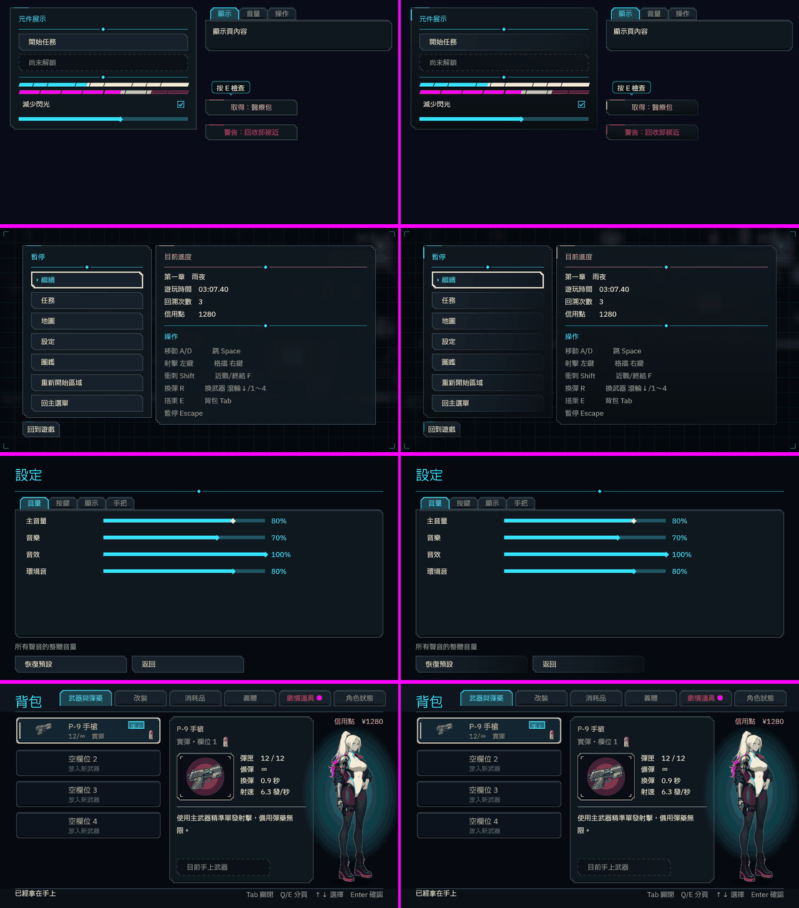

# [NE-392] 讓介面面板不再是整塊方框

> 狀態：完成

## 內文

### 需求
選單、對話框、武器列與各種面板都是一塊深色方框加一圈邊線，版面看起來像表格，不像這個世界的終端機與全像介面。這張票替共用面板換上有形狀語言的外觀，所有畫面一起改變，不逐頁重排。

### 來源
2026-11-27，使用者貼出教學看板的截圖（青色方框加驚嘆號），指出所有方方框框的東西，不管是介面還是場景裡的，看起來都不精緻，要求更貼合遊戲美術與世界觀。設計見[畫面活化與融入](../../design/22-living-scenes/DESIGN.md)的「方框告示與介面面板」，研究依據見[研究](../../design/22-living-scenes/RESEARCH.md)。

### 驗收條件
- [x] 共用面板不再是四邊等亮邊線的方框：有不對稱的切角、左上角局部加粗的重點邊、往右下淡出的邊線，底色有由上到下的層次；對話與閱讀用的面板維持乾淨實心，不加掃描線；按鈕的底色與邊線往右淡出，像清單裡的一列
- [x] 主選單、暫停、設定、背包、商店、任務／地圖、對話框、死亡與結算畫面全部套用，附各畫面的修前修後截圖
- [x] 選取中、滑過、停用三種狀態一眼分得出來，焦點框清楚；不只靠顏色區分
- [x] 文字、圖示與控制項的位置與大小不變，沒有截字、重疊或被切角切到；720p、1080p 與文字放大都通過既有版面檢查
- [x] 面板只在大小或狀態改變時重畫，沒有每影格成本
- [x] 受影響範圍的測試全過

### 測試流程
1. 開主選單、設定、暫停、背包、商店與對話
2. 預期面板有切角與重點邊，不是整塊方框
3. 用鍵盤與手把移動焦點，預期選取與滑過狀態清楚
4. 把文字放大到最大，預期沒有截字

---

# 跟其他票的關係

- Blocks：無
- Blocked by：無
- Related：NE-228、NE-389、NE-390

---

# Commit-1

## 內文

選單、對話框、橫幅與各種面板都是一塊單色深底加一圈等亮邊線，按鈕是方框裡再疊方框。
現在全專案共用的面板換了外觀：底色由上到下漸深，邊線離左上角越遠越淡，左上角的重點色從上緣延伸到左緣並加粗。對話與閱讀用的面板沿用同一個外觀，維持乾淨實心。按鈕的底色與邊線往右淡出，像清單裡的一列；鍵盤與手把的焦點框維持整圈白色粗線，停用的按鈕仍是虛線框，三種狀態不只靠顏色區分。文字、圖示與控制項的位置和大小都沒有動。主選單、暫停、設定、背包、對話框、橫幅、死亡與結算畫面因為共用同一個形狀，全部一起改變。
720p 與 1080p 加文字放大 1.3 倍各拍一輪全部畫面，沒有截字、重疊或被切角切到。面板只在大小或狀態改變時重畫。

### 測試結果

| 項目 | 結果 |
|---|---|
| 受影響範圍的測試（51 個套件） | 59178 項檢查；第一輪有 1 項失敗：對話面板被加上掃描線，違反閱讀面板要乾淨實心的既有規則。拿掉面板掃描線後，重跑相關的三個套件 8493 / 8493 通過 |
| 腳本錯誤 | 0 |
| 原生截圖（15 個畫面 × 720p，以及 1080p 加文字放大 1.3 倍） | 無錯誤、無截字 |

### 截圖

左：修前；右：修後。由上到下：元件展示、暫停、設定、背包。

