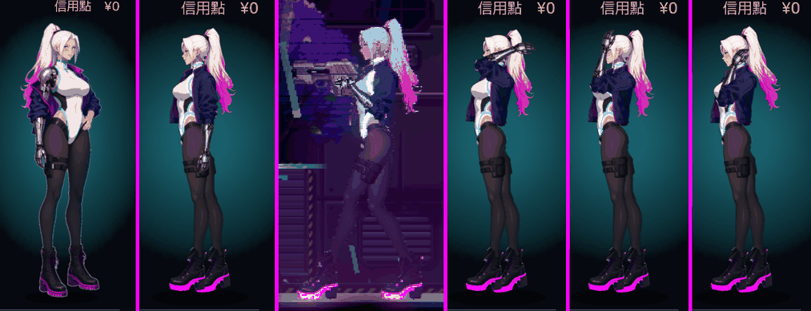

# [NE-393] 讓背包立繪和遊戲內的凜一致並會動

> 狀態：完成

## 內文

### 需求
背包右側的凜是一張另外畫的靜態立繪，髮型、外套、手臂與配色和遊戲裡實際操作的主角不一樣，而且完全不會動。這張票讓背包裡看到的就是遊戲裡的那個凜，並且有呼吸與偶爾出現的小動作。

### 來源
2026-11-27，使用者貼出背包畫面右側的凜立繪，指出她和遊戲裡的主角長得不太一樣，要求修正，並讓她會動：呼吸，或時不時做一些動作（撥頭髮、思考等等）。設計見[畫面活化與融入](../../design/22-living-scenes/DESIGN.md)的「背包立繪」。

### 驗收條件
- [x] 背包右側的凜和遊戲內的主角是同一個外觀：髮型、外套、義肢、鞋與配色一致，附背包畫面與遊戲內近拍的並排截圖
- [x] 她會呼吸、眨眼、偶爾換重心；每隔一段時間做一個小動作，至少包含撥頭髮與思考兩種，同一個動作不連續出現
- [x] 小動作的起手、停留與收回自然，手不穿過頭與身體，動作結束後回到原本的站姿；附兩種動作各自的連續畫面
- [x] 主角在遊戲裡換了外觀或受損狀態時，背包裡看到的跟著一致，不需要另外維護一張圖
- [x] 「減少動態」開啟時維持靜止站姿
- [x] 立繪不擋文字、焦點與按鈕；720p、1080p 與文字放大都通過既有版面檢查
- [x] 背包關閉時不更新也不佔用額外的畫面資源；反覆開關不累積節點
- [x] 受影響範圍的測試全過

### 測試流程
1. 進關卡後開背包，看右側的凜
2. 預期她和畫面上操作的主角是同一個外觀，並且在呼吸
3. 停留三十秒，預期看到撥頭髮或思考的小動作，做完回到站姿
4. 開啟「減少動態」再開背包，預期她站著不動
5. 切到每個分頁，預期立繪不蓋住任何文字或按鈕

---

# 跟其他票的關係

- Blocks：無
- Blocked by：無
- Related：NE-215、NE-244、NE-250

---

# Commit-1

## 內文

背包右側的凜是一張另外畫的正面靜態立繪：頭髮放下、外套敞開、手插腰，和遊戲裡綁馬尾、側身持槍的主角不是同一個樣子，而且完全不會動。
現在背包裡看到的就是遊戲內的那個凜：用同一個角色骨架與同一份貼圖以高倍率畫出來，髮型、外套、義肢、鞋與配色不可能再不一致；她受傷後衣物脫落的樣子也跟著主角目前的生命比例。她會呼吸、眨眼、換重心，每隔 6 到 11 秒做一個小動作：新增了「撥頭髮」（手抬到額側往後順過馬尾）與「思考」（手托下巴、低頭停留兩三秒），加上整理領口與伸展，同一個動作不連續出現，做完回到站姿。「減少動態」開啟時是靜止站姿。原本那張靜態立繪已經沒有地方使用，從專案移除。
放大檢查時發現手臂抬高會露出肩膀下方一塊棕色色塊（外套袖孔的底色），已把那一塊改成外套內側的深色，袖孔以外的像素完全沒有變；修正同時存成角色建置流程的覆蓋圖，之後重建角色不會被蓋掉。這個修正在關卡裡往上瞄準、揮擊時同樣有效。
背包關閉後角色與它的畫面資源都會釋放，反覆開關只有一份。

### 測試結果

| 項目 | 結果 |
|---|---|
| 受影響範圍的測試（55 個套件） | 70502 項檢查，1 項失敗一次：BG-64 擺設受力方向的檢查用了固定影格數等待，負載高時彈簧還沒開始動（與本票無關）。已把那項檢查改成等到真的開始移動，重跑環境與介面兩個套件 8399 / 8399 通過 |
| 腳本錯誤 | 0 |
| 原生情境（開背包、撥頭髮、思考、關背包） | 兩個手勢都播出，關閉後資源已釋放 |

### 截圖

由左到右：修前的靜態立繪、修後的背包立繪、關卡裡的主角（放大）、撥頭髮兩格、思考一格。

