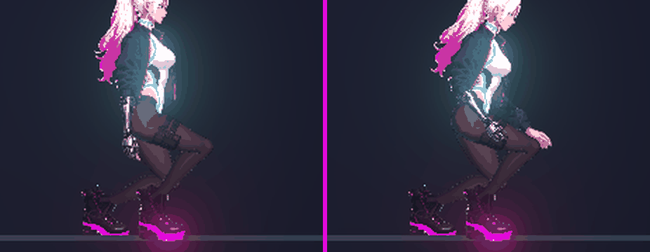

# [NE-394] 讓空手蹲下的姿勢自然有支撐

> 狀態：完成

## 內文

### 需求
主角空手或拿近戰武器蹲下時，上身直挺挺地立著、兩隻手臂筆直垂在身側，重心落在腳跟後面，像僵硬的半蹲。這張票讓這個蹲姿看起來是真的蹲著：上身前傾壓在腳上、手臂有地方放。同時檢查持槍的單膝跪與蹲姿相關的預覽工具。

### 來源
2026-11-27，使用者看過背包立繪的修正後，要求一併優化各種蹲下的骨架，以及讓格擋時有比較合適的動作。

### 驗收條件
- [x] 空手蹲下時上身明顯前傾、骨盆比修前低，重心落在雙腳上方；附修前修後同角度截圖
- [x] 空手蹲下時前臂放在前膝上，不再筆直垂在身側；起身後手臂回到和沒蹲過時一樣的垂放位置
- [x] 蹲下時雙腳仍踩在地面，沒有浮空或陷地（自動檢查量腳底）
- [x] 持槍的單膝跪檢查過：試過的調整若沒有比原本好就維持原樣，並在票上記錄試了什麼
- [x] 其他角色的蹲姿不受影響；蹲姿資料損毀時記錄是哪個角色並沿用原本的姿勢
- [x] 角色預覽工具的蹲下與遊戲一致（有槍才單膝跪，空手是雙腳蹲）
- [x] 受影響範圍的測試全過

### 測試流程
1. 空手（或拿近戰武器）在關卡裡按住蹲下
2. 預期上身前傾、前臂放在膝上，雙腳踩地
3. 放開蹲下，預期手臂回到原本的垂放
4. 換成槍再蹲，預期是原本的單膝跪

---

# 跟其他票的關係

- Blocks：無
- Blocked by：無
- Related：NE-222、NE-395

---

# Commit-1

## 內文

主角空手或拿近戰武器蹲下時，上身幾乎是直立的，兩隻手臂筆直垂著，像半蹲著罰站。
現在這個蹲姿上身往前傾、骨盆再低一點，前臂放在前膝上，另一隻手收在大腿旁；起身時手臂順著放回原本的位置。雙腳仍踩在地面上。
持槍的單膝跪也檢查過：試了把前腳往前伸（前膝不高過髖）與把後大腿打直兩種調法，前者讓整個人拉成弓箭步、後者讓前腳掌翹起，都比原本差，所以維持不動。
角色預覽工具原本不管有沒有槍都畫單膝跪，看不到空手的蹲姿；現在和遊戲一致。其他角色沒有這組資料，蹲姿不變。

### 測試結果

| 項目 | 結果 |
|---|---|
| 受影響範圍的測試 | 通過 71080 / 71080（61 個套件，蹲姿與格擋的修改一起跑） |
| 腳本錯誤 | 0 |
| 空手蹲的自動檢查 | 上身前傾超過 0.2 弧度、腳底離地變化小於 1 像素、起身後手的位置與沒蹲過的對照角色相差小於 0.75 像素 |

### 截圖

左：修前；右：修後（空手蹲下，角色預覽工具，原生 Forward+）。

