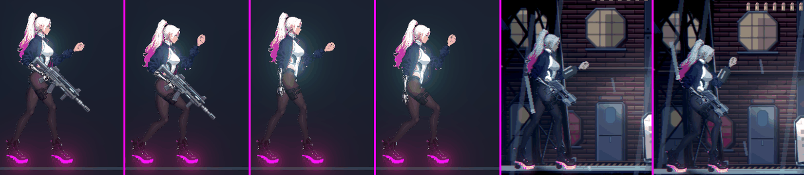

# [NE-395] 讓格擋的架勢像在擋住衝擊

> 狀態：完成

## 內文

### 需求
主角格擋時站得筆直，支撐偏折板的前臂平平地伸在胸前，看起來像把手伸出去，不像準備擋下攻擊。這張票讓格擋有承受衝擊的架勢。

### 來源
2026-11-27，使用者看過背包立繪的修正後，要求一併優化各種蹲下的骨架，以及讓格擋時有比較合適的動作。

### 驗收條件
- [x] 格擋時支撐手的前臂抬高擋在上半身前方（手腕高於肩線），偏折板跟著前臂立起來；附修前修後同角度截圖與遊戲內實景
- [x] 站定格擋時重心壓低、膝蓋微彎，雙腳仍踩在原地；放開後回到原本的站高
- [x] 格擋時頭略低、下巴收在前臂後方
- [x] 抬高的前臂不碰到收在腰側的槍
- [x] 格擋的判定、角度、時間窗、消耗與反彈規則完全不變（既有戰鬥與格擋測試全過，不改測試）
- [x] 其他角色的格擋不受影響；架勢資料損毀時逐項退回預設並記錄是哪個角色的哪一項
- [x] 受影響範圍的測試全過

### 測試流程
1. 在關卡裡按住格擋
2. 預期前臂抬到上半身前方、膝蓋微彎、頭略低
3. 放開格擋，預期回到原本的持槍站姿
4. 格擋時被子彈打中，預期擋下與反彈的結果和以前一樣

---

# 跟其他票的關係

- Blocks：無
- Blocked by：無
- Related：NE-269、NE-332、NE-394

---

# Commit-1

## 內文

主角格擋時站得筆直，前臂平伸在胸前，像把拳頭遞出去。
現在格擋時支撐手的前臂抬高、斜立在上半身前方，偏折板跟著立起來擋住胸口到臉；站定時骨盆下降、膝蓋微彎，上身再往前壓一點，頭略低收在前臂後面。雙腳踩在原地不動，放開後回到原本的站高。走動中格擋時下半身仍用原本的步伐。
這些只改畫面上的架勢：格擋的判定、可擋角度、完美格擋時間窗、防禦量與反彈規則都沒有動。其他角色沒有這組資料，格擋的樣子不變。

### 測試結果

| 項目 | 結果 |
|---|---|
| 受影響範圍的測試 | 通過 71080 / 71080（61 個套件，蹲姿與格擋的修改一起跑） |
| 腳本錯誤 | 0 |
| 格擋架勢的自動檢查 | 手腕高於肩線且在身前、骨盆下降超過 1.5 像素、腳底離地變化小於 1 像素、放開後站高差小於 0.75 像素 |

### 截圖

每組左修前、右修後：持槍格擋、空手格擋（角色預覽工具）、遊戲內實景（偏折板展開）。

